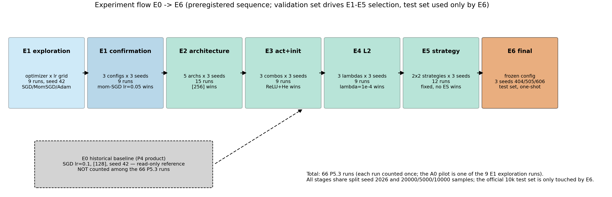
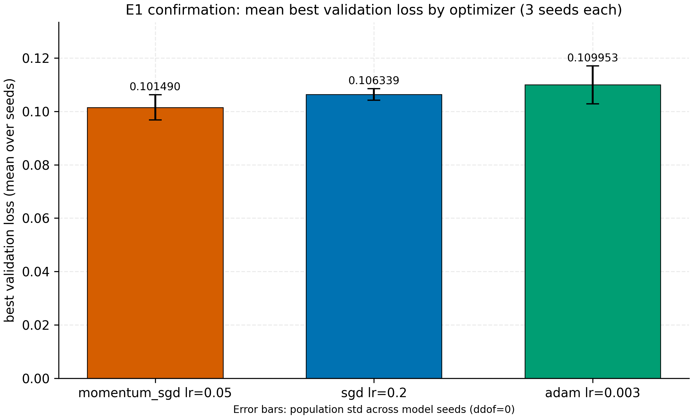
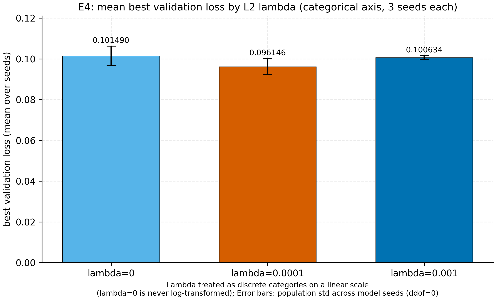
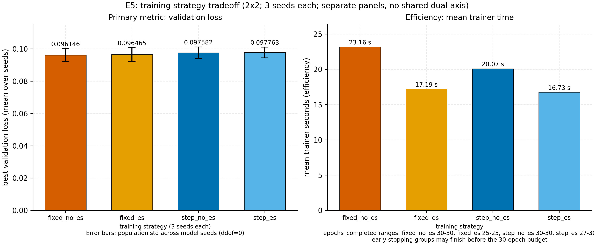
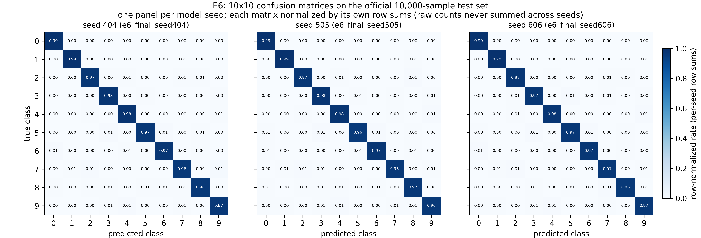
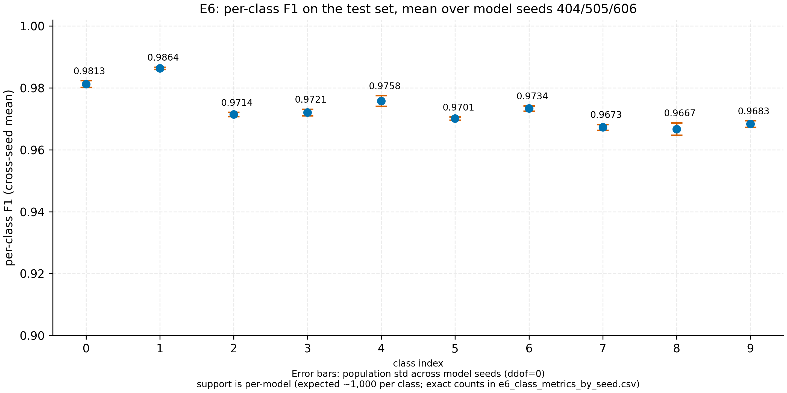

# 手写 NumPy MLP 的 MNIST 分类实验：可复现训练、系统对照与最终评估

- 版本：P6.2 成稿 V0.1（依据《P6.2 课程报告成稿与制图规格 V0.1》与已冻结的 P6.1 证据清单/大纲撰写）
- 日期：2026-10-25
- 证据基线：git 仓库 `mlp-coursework`，HEAD = `90615b86260c0e405a284fe8650c903e41062577`（main，与 origin/main 同步）
- 作者/学校/课程信息：**留空**。本地证据中未找到教师提供的模板或评分标准（rubric），报告结构与格式遵循项目冻结的报告规格；若课程另有格式要求，需据此重新排版。
- 写作约定：已核验事实直接陈述；描述性观察与可能解释以"观察到/与……一致/可能"等措辞标记；所有核心数字由本阶段从原始产物复算（见 `figure_manifest.md` 与 `derived_data/`），loss 保留 6 位小数、accuracy 以百分比保留 2 位小数，完整精度数值见派生数据文件与本报告附录。**全部 66 个 P5.3 运行与 E0 基线产物在制图前后经 SHA-256 核验未发生任何变化。**

---

## 1. 摘要

本报告记录了一个不依赖任何机器学习框架、以 NumPy 手写实现的多层感知机（MLP）在 MNIST 手写数字分类任务上的系统性对照实验。实验在冻结的预注册流程下进行：E0 历史基线核验后，依次完成 E1 优化器/学习率（探索 9 run + 三种子确认 9 run）、E2 网络架构（15 run）、E3 激活函数与自动初始化组合（9 run）、E4 L2 正则化（9 run）、E5 训练策略（12 run），最终在 E6 以冻结配置训练三个最终模型（seed 404/505/606）并在官方 10,000 样本测试集上一次性评估，共 66 个 P5.3 运行。

按预注册主指标（best_validation_loss，组内均值）依次选定：MomentumSGD（lr=0.05）、单隐层 [256]、ReLU+He normal 组合、L2 λ=0.0001、固定学习率无早停。最终模型测试结果（跨 seed 描述性统计）：test loss 0.087566 ± 0.001882，test accuracy 97.35% ± 0.01 pp，macro F1 0.973271 ± 0.000123（±为三个模型种子间的总体标准差，ddof=0，不是置信区间）。混淆矩阵逐类分析显示误差主要分布在 4/9、7/2、3/5、8/5 等易混类别对。

本报告明确披露主要局限：训练仅使用官方 60,000 训练样本中的 20,000 子集；多数对比每组仅 3 个模型种子，全部统计为描述性统计，未做显著性检验；E3 的激活函数与初始化策略为耦合比较；E3/E4/E5 在 [128] 对照结构上验证组件而最终模型采用 [256]，属于按预注册顺序组合组件而非完整因子实验；测试集仅用于 E6 最终评估，不参与任何选型。

**关键词**：多层感知机；NumPy；MNIST；预注册实验；测试集隔离；描述性统计；可复现性

## 2. 研究目标与任务定义

### 2.1 任务定义

任务为 MNIST 手写数字（0–9）多分类：输入为 28×28 灰度图（展平为 784 维向量，像素值缩放至 [0,1]），输出为 10 类概率分布。核心约束是**从零实现**：网络前向/反向传播、损失函数、优化器、数据管线与训练闭环均只用 NumPy 与 Python 标准库手写，不使用 PyTorch/TensorFlow/Keras/JAX/scikit-learn 等任何机器学习框架（事实，见仓库 `README.md` 实现声明）。

### 2.2 研究目标

在固定的计算预算（20,000 训练样本、30 epoch、batch size 128）与冻结的切分协议下，通过一系列单变量或受控多变量对照实验回答：

1. 三类经典优化器（SGD、MomentumSGD、Adam）及其学习率在该任务上的相对表现（E1）；
2. 网络宽度/深度对验证损失的影响（E2）；
3. 激活函数与自动初始化组合的影响（E3）；
4. L2 正则化系数的影响（E4）；
5. 学习率调度与早停策略在性能与训练耗时之间的权衡（E5）；
6. 上述组件按预注册顺序组合后的最终配置在封存测试集上的性能（E6）。

### 2.3 证据与报告边界

本报告只整理、分析、展示已经存在的实验证据（E0–E6 的 config.json、history.csv、summary.json、best_model.npz、聚合产物与各阶段执行/审计报告），不包含任何新实验。事实、描述性观察、可能解释与局限分开陈述；未能本地核验的事项明确标注。

## 3. 手写 NumPy MLP 方法与实现

### 3.1 模块结构（事实）

实现分布于仓库 `src/`（文件职责引自 README 与各阶段报告，P6.2 未修改任何源码）：

| 模块 | 职责 |
| --- | --- |
| `mlp.py` | MLP 网络：He/Xavier 正态初始化、forward（含缓存）、backward、predict、参数备份/恢复 |
| `activations.py` | ReLU/Sigmoid/Tanh 及导数、按名称解析；Sigmoid 数值稳定实现 |
| `losses.py` | 数值稳定 Softmax 与 `softmax_cross_entropy`（log-sum-exp；批次平均梯度 (P−Y)/m） |
| `optimizers.py` | SGD/MomentumSGD/Adam；两阶段更新（候选值有限性验证 + 原子就地提交） |
| `mnist_data.py` | IDX gzip 解析（magic/维度/payload/标签范围校验）、显式下载（临时文件→结构校验→原子替换，双镜像）、预处理、按比例分层随机切分 |
| `training.py` | mini-batch 训练循环、按样本数加权的批量评估、按 val_loss 选最佳 checkpoint（并列取更早 epoch）、npz checkpoint 保存/安全加载、运行目录与产物编排 |
| `train_mnist.py` | 命令行入口与参数校验 |
| `experiments.py` | 跨 run 严格聚合器（strict 模式、schema 校验、组级统计） |

### 3.2 网络与训练语义（事实）

- 前向：线性层 `z = Wx + b`，隐藏层逐元素激活，输出层为线性 logits；Softmax 交叉熵的梯度和数值计算经 log-sum-exp 稳定化。
- 初始化：`initializer=auto` 规则——ReLU 隐藏层用 He normal，Tanh/Sigmoid 隐藏层与输出层用 Xavier normal。E3 的比较对象因此是"激活函数 + auto 初始化"的组合（见第 9 章与第 13 章局限）。
- 优化器：SGD 为基础实现；MomentumSGD 引入动量项（momentum=0.9）；Adam 采用 β1=0.9、β2=0.999、ε=1e-8（各 run `config.json.training` 字段）。所有优化器采用两阶段更新：先计算候选参数并验证有限性，再原子提交，避免中途失败留下半更新状态。
- 学习率调度：`step` 调度（step_size=10，gamma=0.5）或 `none`（固定学习率）；早停以验证损失为判据（patience=5，min_delta=1e-4），实现于 P5.3 阶段（提交记录 fa4336a、778f9a0 等，见 A2/B1 等报告的 git log 摘录）。
- L2 正则化：损失中加入 λ·‖W‖² 项（λ 由 `--l2-lambda` 控制）。
- checkpoint：训练按 epoch 内验证集 `best_validation_loss` 保存最佳参数至 `best_model.npz`（无 pickle；加载时 `allow_pickle=False` 并校验键/形状/数值有限性，E6-B 报告 §3 逐 run 验证）。
- 可复现性：双种子职责——`split_seed`（2026）决定数据切分，`model_seed` 决定参数初始化与逐 epoch 的样本打乱顺序（同一 Generator 顺序派生）；相同数据 + 相同种子必然产生相同划分与训练轨迹。P6.1 复算提供的旁证：同一配置（[128]/ReLU/MomentumSGD lr=0.05/λ=0，seeds 101/202/303）在四个批次独立重跑，组级均值与标准差逐位一致。

### 3.3 聚合与异常安全（事实）

每个 run 落盘四件产物（config.json / history.csv / summary.json / best_model.npz）；聚合器以 strict 模式校验 schema、组内配置一致性并输出组级统计（runs.json / groups.json / report.json）。E6-A-R2 整改为分类指标实现增加了极大整数校验等异常安全处理（`e6整改问题1.md`）。E6 三个 run 的 summary 均为严格 JSON（无 NaN/Infinity，E6-B 报告 §3）。

## 4. MNIST 数据、预处理与切分

**事实**（来源：`README.md`、各 run `config.json.data`、`P5.3-A0_report.md` §2）：

- 数据为四个官方 IDX gzip 文件（train-images 9,912,422 字节、train-labels 28,881 字节、t10k-images 1,648,877 字节、t10k-labels 4,542 字节），本地已就绪，全程未联网、未使用 `--download`。
- 预处理：uint8 → float64 / 255.0，展平为 (N, 784)，取值 [0,1]；标签为 int64 类别索引 0–9；不做 one-hot、不做标准化/PCA/数据增强。
- 切分：训练/验证仅从官方 60,000 训练样本中按类别分层随机抽取（每类按比例配额、最大余数法保证总数精确、类内以显式 seed 打乱），得到 **20,000 训练 / 5,000 验证**；**官方 10,000 测试样本整体保留，不参与切分与训练**。
- **必须强调：本实验的训练集是官方训练集的 20,000 子集，不是完整 60,000 训练集**；所有结论与该计算预算和切分协议绑定。
- 种子职责：`split_seed=2026` 决定切分；`model_seed` 决定初始化与打乱顺序。66 个 P5.3 运行的 `sample_counts` 与 `split_seed` 经 P6.2 复核全部一致。

## 5. 实验设计、主指标与测试集隔离协议

### 5.1 预注册流程

实验按预注册顺序推进（图 1）：E0 历史基线核验（P4 产物，只读）→ E1 优化器/学习率 → E2 架构 → E3 激活+初始化 → E4 L2 → E5 训练策略 → E6 冻结与最终评估。E1 采用"单 seed 探索定位候选 + 三种子确认"两段式；E2–E5 为受控矩阵（每组 3 个模型种子）；E6 在配置冻结后训练三个最终模型（seeds 404/505/606）。每阶段的变量、固定项与运行数见图 1 与附录 A。



**图 1** E0–E6 预注册实验流程。E0 为 P4 历史产物，作只读历史参照，不计入 66 个 P5.3 运行；A0 Pilot 即 E1 exploration 9 个运行之一，不重复计数。

### 5.2 主指标与统计口径

- 主选型指标：`best_validation_loss`（训练中按验证集损失保存的最佳 epoch 值）的组内均值；accuracy 为次指标。组内波动用**跨模型种子的总体标准差**（population std，ddof=0）描述。这是描述性统计，**不是置信区间**，全文不声称统计显著。
- 验证集用于 E1–E5 的实验比较与配置选择；测试集只在配置冻结后由 E6 使用一次。产物层面的隔离证据：E1–E5 全部 63 个 run 的 `evaluate_test=false`（summary 中 `test_evaluation=not_run`），仅 E6 的 3 个 run 为 `true`/`executed`（P6.1 清单 §3、P6.2 复核一致）。
- E6 测试指标为同一固定测试集上三个模型的跨 seed 描述性统计；support 按单模型 10,000 报告，**不相加为 30,000**。

## 6. E0 历史基线（只读历史参照）

E0 为阶段 4（P4）产物 `outputs/mnist_baseline/baseline_30ep_consistency_fix/`：784→[128]→10、ReLU、auto 初始化、SGD lr=0.1、30 epoch、batch 128、seeds 42/2026。其记录值为：best_validation_loss 0.125406、测试 loss 0.120993、测试 accuracy 96.27%（来源：该 run 的 summary.json，P6.1 复算一致）。

**口径声明**：E0 的配置与最终模型（MomentumSGD lr=0.05、λ=1e-4、[256]）在优化器、学习率、正则化与架构上均不同，且 E0 无 P5.3 式的逐项审计。E0 只作为"项目起点"的历史参照，本报告不将 E0 与 E6 的 96.27% → 97.35% 差值归因于任何单一改动（见第 13 章局限 6）。

## 7. E1 优化器与学习率：探索与确认

### 7.1 探索网格（9 run，seed 42，单次）

探索网格覆盖三优化器各三个学习率（来源：`_aggregate_E1_exploration/runs.json` 与派生文件 `e1_exploration_candidates.csv`）：

| optimizer | lr | best val loss | best val acc |
| --- | ---: | ---: | ---: |
| SGD | 0.05（A0 Pilot） | 0.164786 | 94.94% |
| SGD | 0.1 | 0.125406 | 95.76% |
| SGD | 0.2 | 0.102666 | 96.60% |
| MomentumSGD | 0.01 | 0.124745 | 96.02% |
| MomentumSGD | 0.03 | 0.103668 | 96.80% |
| MomentumSGD | 0.05 | 0.100985 | 96.98% |
| Adam | 0.0003 | 0.120156 | 96.46% |
| Adam | 0.001 | 0.103693 | 97.16% |
| Adam | 0.003 | 0.102439 | 96.84% |

各优化器损失最优的学习率（SGD 0.2、MomentumSGD 0.05、Adam 0.003）进入确认组。Pilot（SGD lr=0.05）运行于其余 8 个候选之前，用于验证管线端到端可用，属 9 个候选之一。

### 7.2 三种子确认组（9 run = 3 配置 × seeds 101/202/303）

| 配置 | mean best val loss | 总体 std | mean best val acc |
| --- | ---: | ---: | ---: |
| **MomentumSGD, lr=0.05** | **0.101490** | 0.004761 | **97.05%** |
| SGD, lr=0.2 | 0.106339 | 0.002187 | 96.76% |
| Adam, lr=0.003 | 0.109953 | 0.007131 | 96.83% |

按预注册主指标选定 **MomentumSGD, lr=0.05**（图 2）。观察到 SGD 的种子间波动最小、Adam 最大，但这些是 3 个种子下的描述性观察，不构成稳定性结论。



**图 2** E1 确认组三配置的 mean best validation loss；误差条为跨模型种子总体标准差（ddof=0）。数据源：`derived_data/e1_confirmation.csv`（原始值见 `_aggregate_E1_confirmation/groups.json`）。

## 8. E2 架构对比（15 run = 5 架构 × 3 seeds）

固定 MomentumSGD lr=0.05、ReLU、auto 初始化、λ=0，比较五个架构：

| hidden_dims | 参数量 | mean best val loss | 总体 std | mean best val acc |
| --- | ---: | ---: | ---: | ---: |
| [64] | 50,890 | 0.116248 | 0.004981 | 96.67% |
| [128] | 101,770 | 0.101490 | 0.004761 | 97.05% |
| [128,64] | 109,386 | 0.106400 | 0.002738 | 96.99% |
| **[256]** | 203,530 | **0.092419** | 0.004048 | 97.23% |
| [256,128] | 235,146 | 0.097490 | 0.002709 | 97.25% |

按主指标选定 **[256]**（图 3）。[256,128] 的平均验证准确率（97.25%）略高于 [256]（97.23%），但 accuracy 不是预注册的首要选型指标，**不得以事后理由替换选型规则**；该差异（约 0.02 pp）远小于组内种子波动，属于描述性观察。宽单层 [256] 以少于深两层 [256,128] 的参数量（203,530 vs 235,146）取得更低的验证损失，可能与 30 epoch 预算下更深网络收敛更慢有关——这是与观察一致的可能解释，不是结论。


**图 3** E2 五架构的 mean best validation loss ± 总体标准差，横轴标注参数量；架构作离散类别（不当作连续宽度拟合）。数据源：`derived_data/e2_architecture.csv`。

## 9. E3 激活函数与 auto 初始化组合（9 run = 3 组合 × 3 seeds）

固定 [128]、MomentumSGD lr=0.05、λ=0，比较三个"激活 + auto 初始化"组合：

| 组合 | mean best val loss | 总体 std | mean best val acc |
| --- | ---: | ---: | ---: |
| **ReLU + He normal** | **0.101490** | 0.004761 | **97.05%** |
| Tanh + Xavier normal | 0.106333 | 0.003405 | 96.86% |
| Sigmoid + Xavier normal | 0.136377 | 0.002177 | 95.87% |

选定 **ReLU + He normal（auto）**（图 4）。**必须声明：本实验同时改变激活函数与初始化策略，比较对象是组合，不能把组间差异归因于激活函数单独作用**（规格与 P6.1 盘点共同确认的口径）。Sigmoid 组合的较高损失可能受 30 epoch 预算内欠训练影响——饱和激活在固定预算下收敛更慢是与观察一致的可能解释，**不能推断其渐近上限**。


**图 4** E3 三个"激活 + auto 初始化"组合的验证损失对比；横轴标签同时标出初始化器以强调耦合比较。数据源：`derived_data/e3_activation.csv`。

## 10. E4 L2 正则化（9 run = 3 λ × 3 seeds）

固定 [128]、ReLU、MomentumSGD lr=0.05，比较三个 λ：

| λ | mean best val loss | 总体 std | mean best val acc |
| ---: | ---: | ---: | ---: |
| 0 | 0.101490 | 0.004761 | 97.05% |
| **0.0001** | **0.096146** | 0.004011 | **97.17%** |
| 0.001 | 0.100634 | 0.000935 | 96.97% |

选定 **λ=0.0001**（图 5）。λ=0.001 的种子间波动最小（std 0.000935），但**较小的种子间波动不等同于整体表现更优**；按主指标它劣于 λ=0.0001。



**图 5** E4 三个 λ 候选的验证损失；λ 作离散类别处理（线性坐标轴，λ=0 不做对数变换）。数据源：`derived_data/e4_l2.csv`。

## 11. E5 学习率调度与早停（12 run = 2×2 × 3 seeds）

在 E4 胜出配置（λ=0.0001）上比较调度器（fixed/step）× 早停（es/no_es）四个策略：

| 策略 | mean best val loss | 总体 std | 平均训练器耗时 (s) | epochs_completed |
| --- | ---: | ---: | ---: | --- |
| **fixed_no_es** | **0.096146** | 0.004011 | 23.16 | 30–30 |
| fixed_es | 0.096465 | 0.004244 | 17.19 | 25–25 |
| step_no_es | 0.097582 | 0.003575 | 20.07 | 30–30 |
| step_es | 0.097763 | 0.003323 | 16.73 | 27–30 |

按主指标选定 **fixed_no_es**（图 6）。早停组如预期在 30 epoch 预算内提前终止（fixed_es 三次运行均在 epoch 25 停止），平均节省约 26% 训练器时间，主指标代价 +0.000319——观察到的时间-性能权衡。按预注册规则，早停不替代主指标选型，仅作为效率讨论；其验收谓词另经独立复核（`P5.3-E5-R1_early_stopping_audit.md`）。



**图 6** E5 四策略的双面板对比：左为主指标（验证损失±总体标准差），右为效率指标（平均训练器耗时）；两面板分离呈现，不使用共享双轴。数据源：`derived_data/e5_strategy.csv`。

## 12. E6 最终冻结配置与测试集评估

### 12.1 冻结配置

按 E1–E5 顺序组合的最终配置（来源：`e6.md` 冻结文档、E6 三个 run 的 config.json）：

| 组件 | 取值 | 选取依据 |
| --- | --- | --- |
| hidden_dims | [256] | E2 主指标最优 |
| 激活/初始化 | ReLU / auto（He normal） | E3 组合最优 |
| 优化器 | MomentumSGD | E1 主指标最优 |
| 学习率 | 0.05（momentum 0.9） | E1 |
| L2 λ | 0.0001 | E4 |
| 调度器/早停 | none / 关闭 | E5 |
| epochs / batch | 30 / 128 | 预算冻结 |
| split seed | 2026 | 全程一致 |
| model seeds | 404 / 505 / 606 | 预注册最终种子 |

该配置是**按预注册顺序组合组件**的结果；E3/E4/E5 的对照结构为 [128]，最终模型采用 [256]，未在 [256] 上重跑全部正则化/策略组合（见第 13 章局限 5）。

### 12.2 测试集评估（一次性）

三个最终 run 均训练至 30 epoch（stop_reason=max_epochs；best epoch 为 29 或 30），配置逐字段匹配冻结表（E6-B 报告 20 项逐项验收 3/3 通过）。测试指标（官方 10,000 样本，每模型一次）：

| seed | test loss | test accuracy | macro P | macro R | macro F1 |
| ---: | ---: | ---: | ---: | ---: | ---: |
| 404 | 0.086905 | 97.36% | 0.973458 | 0.973355 | 0.973390 |
| 505 | 0.090130 | 97.33% | 0.973241 | 0.973033 | 0.973101 |
| 606 | 0.085665 | 97.35% | 0.973407 | 0.973262 | 0.973322 |
| **均值** | **0.087566** | **97.35%** | **0.973368** | **0.973217** | **0.973271** |
| 总体 std | 0.001882 | 0.000125 | 0.000093 | 0.000135 | 0.000123 |

（均值与 std 为跨模型 seed 描述性统计，已与聚合器 `groups.json` 对账一致；完整精度见 `derived_data/e6_final_by_seed.csv`。support 为每模型各自 10,000，**不相加**。）

### 12.3 逐类指标与混淆矩阵

三 seed 的逐类 Precision/Recall/F1 均值与 support（每模型相同，来源 `derived_data/e6_class_metrics_by_seed.csv`）：

| 类别 | support/模型 | Precision | Recall | F1 |
| ---: | ---: | ---: | ---: | ---: |
| 0 | 980 | 0.9742 | 0.9884 | 0.9813 |
| 1 | 1135 | 0.9842 | 0.9885 | 0.9864 |
| 2 | 1032 | 0.9710 | 0.9719 | 0.9714 |
| 3 | 1010 | 0.9679 | 0.9762 | 0.9721 |
| 4 | 982 | 0.9736 | 0.9779 | 0.9758 |
| 5 | 892 | 0.9758 | 0.9645 | 0.9701 |
| 6 | 958 | 0.9739 | 0.9729 | 0.9734 |
| 7 | 1028 | 0.9716 | 0.9630 | 0.9673 |
| 8 | 974 | 0.9694 | 0.9641 | 0.9667 |
| 9 | 1009 | 0.9720 | 0.9647 | 0.9683 |

逐类 F1 的跨 seed 均值见图 8；三张 10×10 行归一化混淆矩阵（每矩阵除以自身行和，原始计数不相加）见图 7。混淆模式与 MNIST 已知的易混类别一致：主要误差出现在 4/9、7/2、7/1、3/5、8/5、9/4 等类别对，与观察到的最低逐类 F1（类别 7、8）相符。



**图 7** E6 三个模型种子的行归一化混淆矩阵（行=真实类别，列=预测类别）。每个矩阵按自身行和归一化；三 seed 的原始计数矩阵不相加。



**图 8** E6 逐类 F1 的跨 seed 均值；误差条为跨模型种子总体标准差（ddof=0）。

### 12.4 分类指标口径核验（事实）

P6.1/P6.2 两阶段独立复算确认：逐类 P/R/F1 可由混淆矩阵按标准定义精确重算（与 summary 记录零偏差）；macro 指标为逐类算术平均（浮点尾差 ≤ 2.22e-16）；每张混淆矩阵总数恰为 10,000；聚合器与逐 run summary 的测试指标零偏差（见 `figure_manifest.md` 复算记录）。

## 13. 讨论、局限、威胁有效性与结论

### 13.1 讨论

**收敛与泛化（描述性观察）**：最终配置下验证与测试表现一致（验证 0.088666±0.000971 vs 测试 0.087566±0.001882；准确率 97.31% vs 97.35%），测试损失略低于验证损失——可能与验证集更小（5,000 vs 10,000）导致的抽样波动有关，属正常现象，不构成"测试集偏易"的证据。E1–E5 各组均值差异多数与组内种子波动同量级（误差条重叠），预注册规则因此只做主指标排序选择，不做优劣显著性声明。

**效果-成本权衡**：E2 中 [256] 以约 2 倍于 [128] 的参数量换取约 0.009 的验证损失改善；E5 中早停节省约 26% 训练时间但主指标略差。这些权衡在 20k/30 epoch 预算内成立，预算变化后可能不同。

**可复现性（事实）**：同一配置在四个批次的独立重跑给出逐位相同的组级统计（P6.1 §5）；全部 66 run 的环境快照一致（Python 3.11.4 / NumPy 2.4.6 / Windows-10-10.0.26200-SP0）。

### 13.2 局限与威胁有效性（必须完整披露）

1. **训练子集**：仅使用官方 60,000 训练样本中的 20,000；验证 5,000；测试 10,000。结论与该计算预算和切分协议绑定。
2. **种子数量与统计口径**：多数对比每组仅 3 个模型种子；均值与总体标准差（ddof=0）是描述性统计，不宣称显著性，也不构造未经预注册的显著性检验。
3. **E3 耦合比较**：激活函数与 auto 初始化策略同时改变（ReLU→He normal；Tanh/Sigmoid→Xavier normal），不能把差异完全归因于激活函数单独作用。
4. **E2 选型指标**：主选型指标是平均最佳验证损失而非 accuracy；[256] 按预注册主指标入选，即使 [256,128] 的 accuracy 略高。
5. **组件组合非完整因子实验**：E3/E4/E5 的冻结对照结构为 [128]，最终模型使用 E2 选定的 [256]。这是预注册顺序下的组件选择流程，不是在最终 [256] 架构上对所有激活、L2 与训练策略的完整 factorial 实验。
6. **E0 不可归因**：E0 历史基线与 E6 最终配置在优化器、学习率、正则化、架构上均不同，不能把两者的性能差值归因于任何单一组件。
7. **测试集共用**：E6 三个模型使用同一固定测试集；跨 seed 均值/标准差是模型波动的描述性统计，不是三个独立测试集的结果；support 按单模型 10,000 给出，不能相加为 30,000。
8. **测试集纪律**：测试集只用于 E6 最终评估，未用于选型、调参、换 seed、换 epoch 或决定补跑（产物级证据：E1–E5 全部 `evaluate_test=false`）。
9. **E2/E3 预注册文件缺口**：`P5.3-E2_架构实验预注册补充_V0.1` 与 `P5.3-E3_激活函数实验预注册补充_V0.1` 的独立文件在 P6.1 盘点中缺失；对应方案内容来自执行报告（B1/C1）的记载，需按此理解其证据等级。
10. **E1/E2 日志缺口**：E1/E2 批次缺少完整独立运行日志，且 E1-A1 的第一个 Run 的 Python 退出码当时未经管道直接捕获；成功性由产物与后续逐项校验支撑，但不能声称所有历史命令均保留了完整独立 stdout/stderr 日志。
11. **无课程格式依据**：本地未找到教师模板或 rubric；本报告格式遵循项目冻结的报告规格，不能保证符合未提供的课程格式要求。
12. **README 文档状态**：公共 README 仍显示 P4 阶段内容，与实际进度（P5.3 完成）不同步；按本阶段纪律未修改 README，引用时不应以 README 作为已完成阶段的唯一证据。

### 13.3 结论

在冻结的预注册协议与 20k/30 epoch 预算下：(1) 主指标排序依次选定 MomentumSGD lr=0.05、[256]、ReLU+He normal、λ=0.0001、fixed_no_es；(2) 组合后的最终配置在官方 10,000 样本测试集上取得 test loss 0.087566 ± 0.001882、accuracy 97.35% ± 0.01 pp、macro F1 0.973271 ± 0.000123（跨 3 个模型种子的描述性统计）；(3) 全部数字可追溯到落盘产物并经两阶段独立复算对账。以上结论不外推到其他数据集、其他预算或完整训练集场景。

### 13.4 后续工作（展望，不承诺结果）

在 [256] 架构上重新验证 E3/E4/E5 的组件选择（补足非因子流程）；解耦激活函数与初始化策略的对照；使用完整 60,000 训练集与更长预算；引入预注册的显著性检验方法（如多种子更多重数下的置换检验）；对 4/9、7/2 等易混类别对做误差专项分析。

## 14. 附录

### 附录 A：运行清点

| 阶段 | run 数 | 模型种子 | role | test_evaluation |
| --- | ---: | --- | --- | --- |
| E1 exploration（含 A0 Pilot） | 9 | 42 | exploration | not_run |
| E1 confirmation | 9 | 101/202/303 | exploration | not_run |
| E2 architecture | 15 | 101/202/303 | exploration | not_run |
| E3 activation | 9 | 101/202/303 | exploration | not_run |
| E4 L2 | 9 | 101/202/303 | exploration | not_run |
| E5 training strategy | 12 | 101/202/303 | exploration | not_run |
| E6 final | 3 | 404/505/606 | final | executed |
| **合计（去重）** | **66** | — | — | — |

E0 为 P4 历史产物，不计入上表。全部 66 run 的 role 字段中 exploration/final 语义说明：确认组按任务书原文使用 `--experiment-role exploration`（A2 报告 §2），阶段语义由目录与聚合分组承载。

### 附录 B：最终冻结配置（完整字段）

来自 `E6_final/e6_final_seed404/config.json`（三 seed 仅 model_seed 不同）：

```json
{
  "network":   {"input_dim": 784, "hidden_dims": [256], "output_dim": 10,
                "hidden_activation": "relu", "initializer": "auto"},
  "training":  {"epochs": 30, "batch_size": 128, "learning_rate": 0.05,
                "optimizer": "momentum_sgd", "momentum": 0.9,
                "beta1": 0.9, "beta2": 0.999, "eps": 1e-08,
                "lr_scheduler": "none", "early_stopping": false,
                "l2_lambda": 0.0001},
  "seeds":     {"model_seed": 404, "split_seed": 2026},
  "data":      {"sample_counts": {"train": 20000, "validation": 5000, "test": 10000}},
  "environment": {"python": "3.11.4", "numpy": "2.4.6",
                  "platform": "Windows-10-10.0.26200-SP0"}
}
```

### 附录 C：指标与统计定义

- **best_validation_loss**：训练过程中完整验证集上最低的交叉熵损失（按样本数加权），并列取更早 epoch。
- **总体标准差（population std, ddof=0）**：组内各模型种子值对组均值的均方根偏差，`statistics.pstdev`。全文误差条均为该量，非置信区间。
- **Precision/Recall/F1（逐类）**：由 10×10 混淆矩阵（行=真实、列=预测）按标准定义计算：precisionᵢ = TPᵢ/(TPᵢ+FPᵢ)，recallᵢ = TPᵢ/(TPᵢ+FNᵢ)，F1ᵢ = 2PR/(P+R)。
- **Macro P/R/F1**：10 类逐类值的算术平均（与逐 run `test_macro_avg` 核验一致）。
- **support**：该类在测试集中的真实样本数（每模型各自统计）。

### 附录 D：软件版本与运行环境

- 实验运行环境（全部 66 run 的 config 快照一致）：Python 3.11.4、NumPy 2.4.6、Windows-10-10.0.26200-SP0。
- 本报告图表生成环境：独立虚拟环境（仓库之外 `../mlp-coursework-report-venv/`），Matplotlib 3.10.9、NumPy 2.4.6、Pillow 13.0.0；详见 `report_environment.txt`。
- 测试基线记录（引自执行报告，本阶段未重跑 pytest）：A0–A2 批次 265 passed（HEAD c3fa369）；E6-B 批次 341 passed（HEAD 90615b8）。

### 附录 E：复现说明

- 图表：`<report-venv>/python.exe outputs/p5.3/P6.2/plot_figures.py`，在仓库根目录执行；脚本只读解析聚合 JSON 与逐 run summary/history，复算组级统计并与 `groups.json` 对账（偏差 > 1e-9 即中止），随后输出 `derived_data/` 与 `figures/`。每图的数据源、字段、筛选规则与复现命令登记于 `figure_manifest.md`。
- 训练与评估：本阶段**未执行**任何训练/评估命令；历史命令见各阶段执行报告（A0/A1/A2/B1/C1/D1/E5/E6-B）原文。
- 源产物保护：制图前后对 237 个源文件（7 个聚合目录全部 JSON、66 run 的 config/summary/history、E6 的 best_model.npz、E0 基线 config/summary、全部 P5.3 报告、P6.1 两文件）做 SHA-256 清单比对，**零变化**（清单与结果见 `figure_manifest.md` §哈希保护）。

### 附录 F：派生数据文件

| 文件 | 内容 | 行数 |
| --- | --- | ---: |
| `derived_data/e1_exploration_candidates.csv` | E1 探索 9 候选逐 run 值（含 is_a0_pilot 标记） | 9 |
| `derived_data/e1_confirmation.csv` | E1 确认组 3 配置组级统计 + run 名单 | 3 |
| `derived_data/e2_architecture.csv` | E2 逐 run 值 + 参数量 | 15 |
| `derived_data/e3_activation.csv` | E3 逐 run 值 + 组合标签 | 9 |
| `derived_data/e4_l2.csv` | E4 逐 run 值 + λ | 9 |
| `derived_data/e5_strategy.csv` | E5 逐 run 值 + 策略/耗时/完成 epoch | 12 |
| `derived_data/e6_final_by_seed.csv` | E6 逐 seed 验证/测试指标 | 3 |
| `derived_data/e6_class_metrics_by_seed.csv` | E6 逐 seed 逐类 P/R/F1/support | 30 |
| `derived_data/e6_confusion_matrices.json` | E6 三 seed 原始计数矩阵 + 行归一化矩阵 | — |

---

*本报告为 Markdown 交付稿（P6.2_final_report.md），为唯一权威源文件；如课程后续指定 Word/PDF 格式，应基于本稿统一排版导出。报告不含任何未在本地证据中出现的内容；对尚不能核验的事项已在正文与局限中如实标注。*
