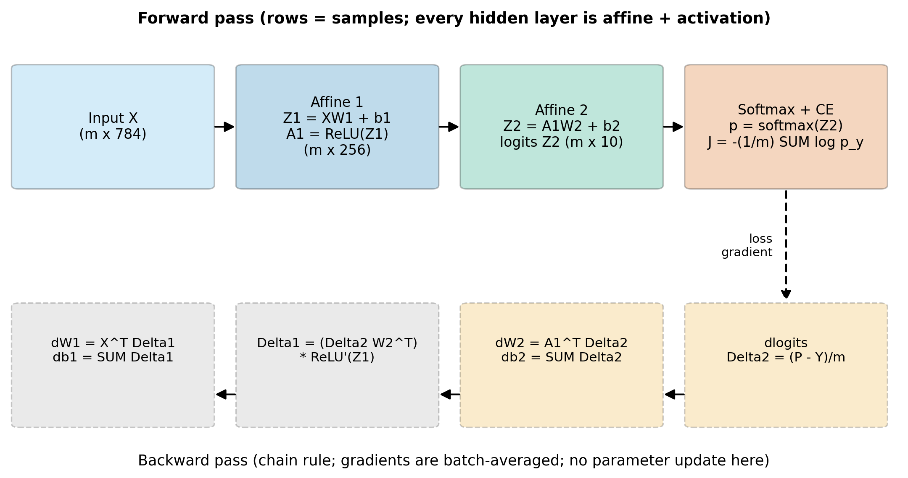
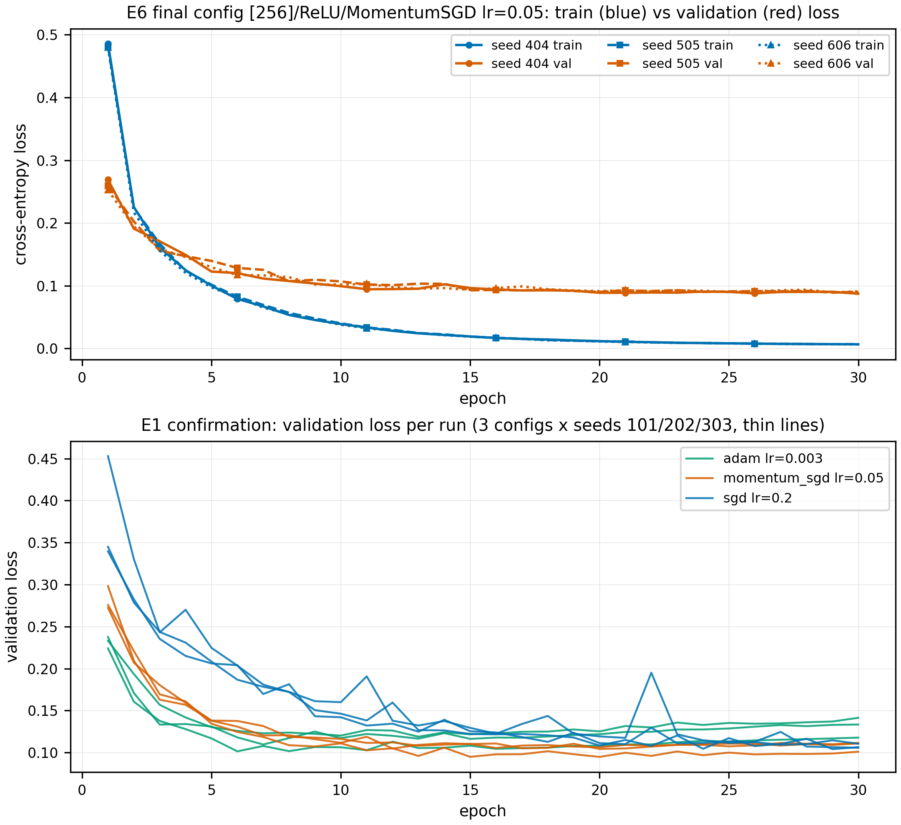
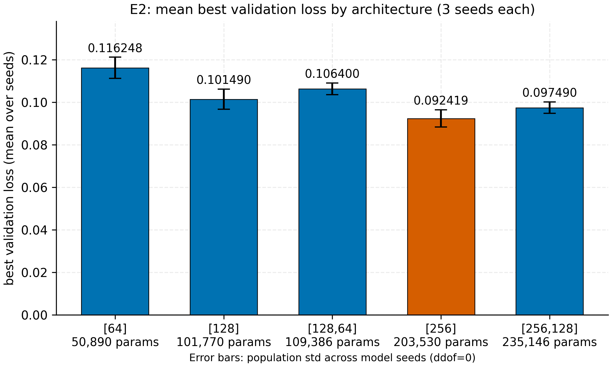
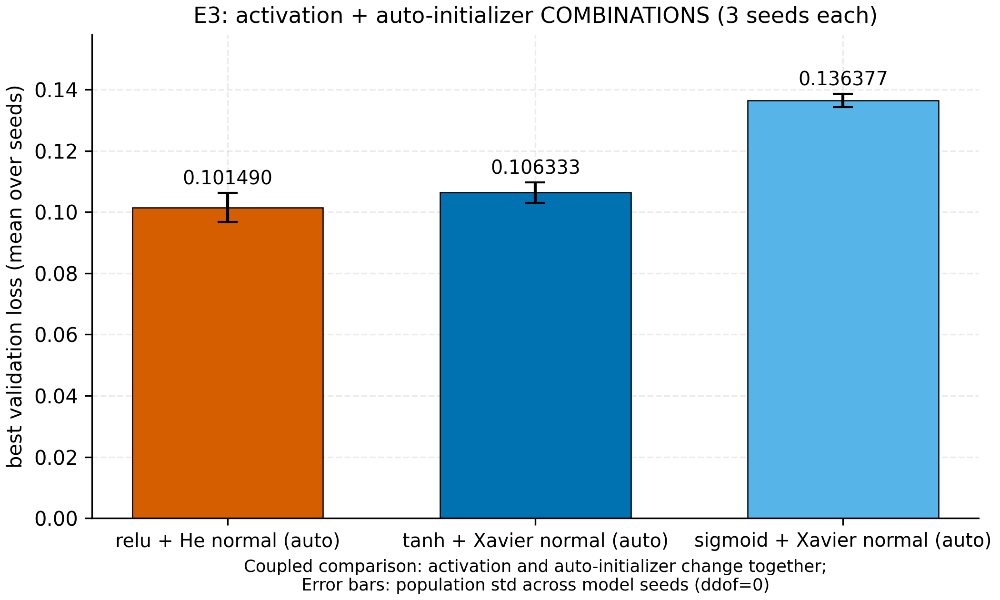
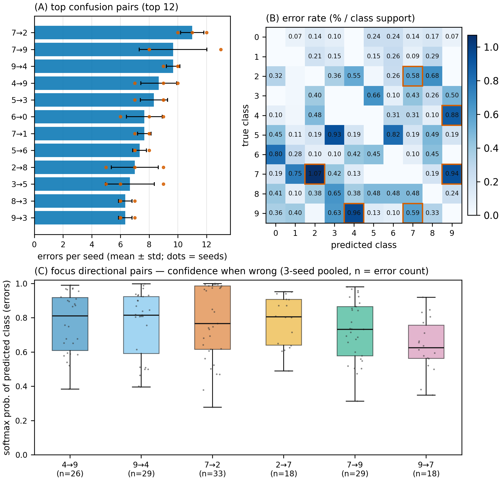
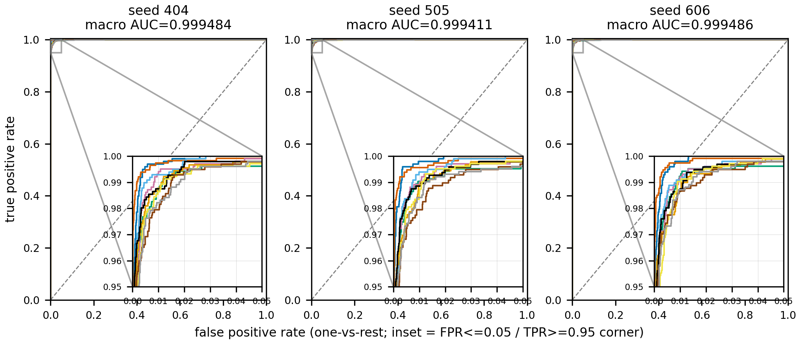
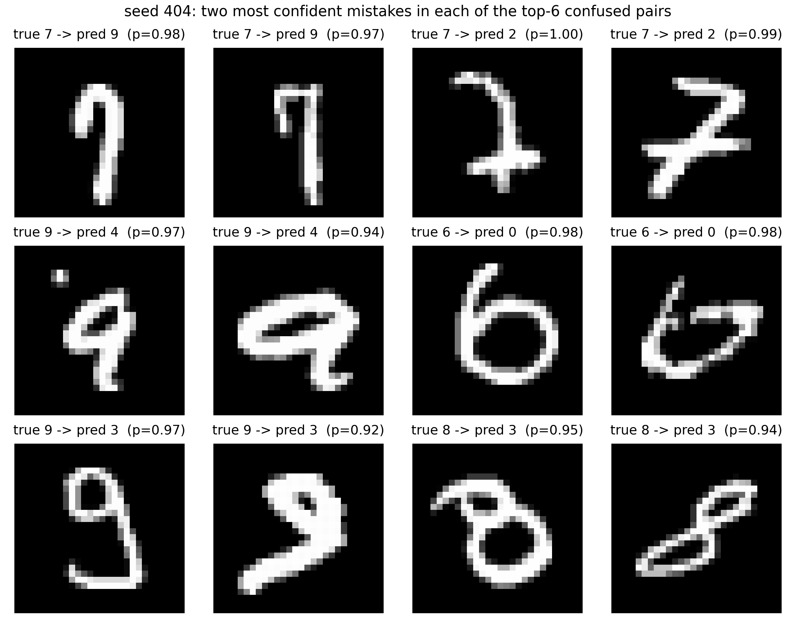
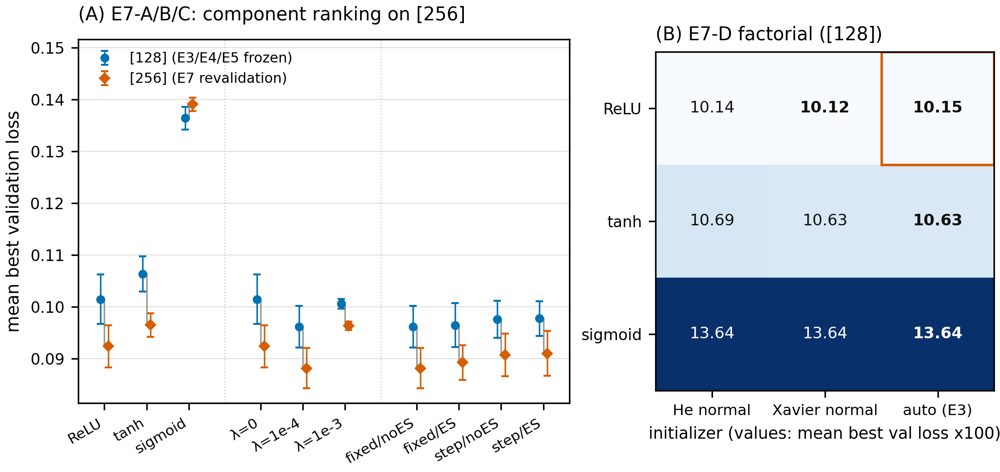
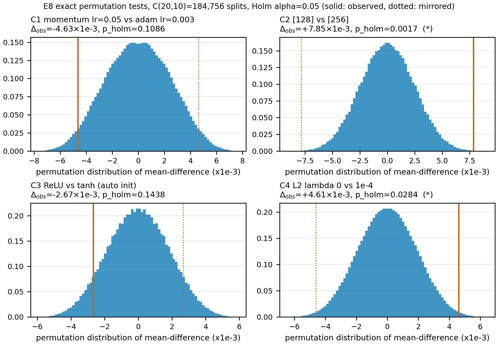
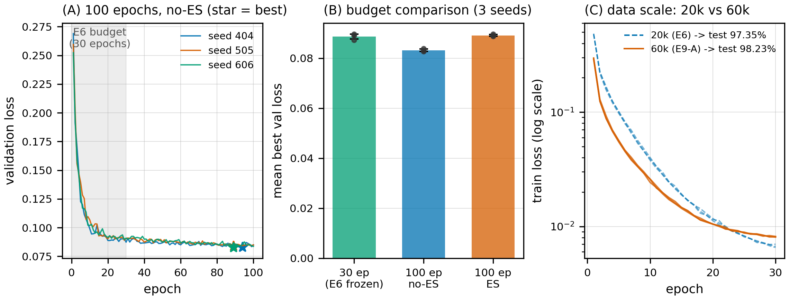

# 手写 NumPy MLP 的 MNIST 分类实验：可复现训练、系统对照与最终评估

- 日期：2026-11-08

---

## 1. 摘要

本报告记录了一个不依赖任何机器学习框架、以 NumPy 手写实现的多层感知机（MLP）在 MNIST 手写数字分类任务上的系统性对照实验。全部实验在冻结的预注册流程下分两轮完成，共 149 个受控运行。第一轮（E0–E6，66 个 P5.3 运行）完成组件选型与最终评估：E0 历史基线核验后，依次完成 E1 优化器/学习率（探索 9 run + 三种子确认 9 run）、E2 网络架构（15 run）、E3 激活函数与自动初始化组合（9 run）、E4 L2 正则化（9 run）、E5 训练策略（12 run），最终在 E6 以冻结配置训练三个最终模型（seed 404/505/606）并在官方 10,000 样本测试集上一次性评估。

按预注册主指标（best_validation_loss，组内均值）依次选定：MomentumSGD（lr=0.05）、单隐层 [256]、ReLU+He normal 组合、L2 λ=0.0001、固定学习率无早停。最终模型测试结果（跨 seed 描述性统计）：test loss 0.087566 ± 0.001882，test accuracy 97.35% ± 0.01 pp，macro F1 0.973271 ± 0.000123（±为三个模型种子间的总体标准差，ddof=0，不是置信区间）。混淆矩阵逐类分析显示误差主要分布在 4/9、7/2、3/5、8/5 等易混类别对。

第二轮（E7–E9，83 个运行）按同一预注册纪律对第一轮的组件选型做系统验证：E7 把 E3/E4/E5 的对照原样搬到最终架构 [256] 并补做激活×初始化完整因子解耦（39 run，排序全部复现）；E8 对 E1–E4 的四个实际选型决定各以 10 个模型种子做精确置换检验（35 个新 run；架构与 L2 选择获得显著性支持，优化器与激活同向未达阈值）；E9 量化延长预算（100 epoch，验证损失 0.0887→0.0832）与完整 60,000 训练样本（9 run，60k 全量测试 98.23%，为预先声明的数据规模研究；交付模型仍为 E6 的 97.35%）。

实验口径与边界：第一轮（E1–E6）结论限定于 20,000 训练样本、30 epoch 预算、每组 3 种子的描述性统计（ddof=0）与该切分协议，完整边界与威胁有效性披露见 §13.2；测试集在全部 149 个运行中仅用于 E6 最终评估与两次预先声明的补充评估，不参与任何选型。

**关键词**：多层感知机；NumPy；MNIST；预注册实验；测试集隔离；描述性统计；可复现性

## 2. 研究背景、目标与任务定义

### 2.1 研究背景

多层感知机（MLP）是深度学习的基础模型，其训练闭环——前向传播、反向传播、损失函数、优化器与正则化——在现代框架中通常被封装为少数几次调用。用 NumPy 从零实现这些环节，可以把它们重新暴露为可检查的矩阵运算与显式状态，便于逐项验证梯度是否正确、优化器是否按预注册规则更新、产物是否可复现。

MNIST 手写数字分类是长期使用的标准基准：10 类、28×28 灰度图、官方 60,000 训练样本与 10,000 测试样本，任务定义清晰，适合作为受控对照实验的载体。它的局限同样明确——任务相对简单、测试集规模有限，因此本报告的结论不外推到更复杂的数据、更大的模型或不同预算。

在方法上，超参数对比常见的问题是选型流程不透明：测试集被反复使用、比较组之间混入多个变量、只报告最优结果而不披露种子波动。本项目因此采用预注册顺序、固定计算预算、训练/验证/测试严格分工与描述性统计口径，把"如何选"与"选出了什么"分开记录，使结论的适用范围可以被明确界定。

### 2.2 任务定义

任务为 MNIST 手写数字（0–9）多分类：输入为 28×28 灰度图（展平为 784 维向量，像素值缩放至 [0,1]），输出为 10 类概率分布。核心约束是**从零实现**：网络前向/反向传播、损失函数、优化器、数据管线与训练闭环均只用 NumPy 与 Python 标准库手写，不使用 PyTorch/TensorFlow/Keras/JAX/scikit-learn 等任何机器学习框架（事实；`requirements.txt` 仅 numpy 与 pytest，无任何机器学习框架依赖）。

### 2.3 研究目标

在固定的计算预算（20,000 训练样本、30 epoch、batch size 128）与冻结的切分协议下，通过两轮预注册对照实验回答。第一轮（E1–E6）回答：

1. 三类经典优化器（SGD、MomentumSGD、Adam）及其学习率在该任务上的相对表现（E1）；
2. 网络宽度/深度对验证损失的影响（E2）；
3. 激活函数与自动初始化组合的影响（E3）；
4. L2 正则化系数的影响（E4）；
5. 学习率调度与早停策略在性能与训练耗时之间的权衡（E5）；
6. 上述组件按预注册顺序组合后的最终配置在封存测试集上的性能（E6）。

第二轮（E7–E9）对第一轮的选型做系统验证：

7. 组件选择在最终架构上的迁移性与激活×初始化解耦（E7）；
8. 四个实际选型决定的多种子统计推断（E8）；
9. 数据规模与训练预算对最终配置的影响（E9）。

### 2.4 证据与报告边界

本报告整理、分析、展示已落盘的实验证据：两轮实验（E0–E6 与 E7–E9）的 config.json、history.csv、summary.json、模型文件、聚合与派生产物（§14）。事实、描述性观察、可能解释与局限分开陈述；未能本地核验的事项明确标注。

## 3. 手写 NumPy MLP 方法与实现

### 3.1 模块结构（事实）

实现分布于仓库 `src/`（文件职责可直接由 `src/` 各模块的文档字符串核对；报告制作全程未修改任何源码）：

| 模块 | 职责 |
| --- | --- |
| `mlp.py` | MLP 网络：He/Xavier 正态初始化、forward（含缓存）、backward、predict、参数备份/恢复 |
| `activations.py` | ReLU/Sigmoid/Tanh 及导数、按名称解析；Sigmoid 数值稳定实现 |
| `losses.py` | 数值稳定 Softmax 与 `softmax_cross_entropy`（log-sum-exp；批次平均梯度 (P−Y)/m） |
| `optimizers.py` | SGD/MomentumSGD/Adam；两阶段更新（候选值有限性验证 + 原子就地提交） |
| `mnist_data.py` | IDX gzip 解析（magic/维度/payload/标签范围校验）、显式下载（临时文件→结构校验→原子替换，双镜像）、预处理、按比例分层随机切分 |
| `training.py` | mini-batch 训练循环、按样本数加权的批量评估、按 val_loss 选最佳 checkpoint（并列取更早 epoch）、npz checkpoint 保存/安全加载、运行目录与产物编排 |
| `train_mnist.py` | 命令行入口与参数校验 |
| `experiments.py` | 跨 run 严格聚合器（strict 模式、schema 校验、组级统计） |

### 3.2 前向与反向传播的数学推导（与实现一致）

以下符号与 `src/mlp.py`、`src/losses.py`、`src/training.py` 的实现一一对应。设一个批次有 $m$ 个样本，输入矩阵 $A^{(0)} = X \in \mathbb{R}^{m \times 784}$；网络共 $L$ 层（含输出层），第 $l$ 层权重 $W^{(l)}$、偏置 $b^{(l)}$，输出层类别数 $K=10$。

**前向传播。** 对 $l=1,\dots,L$：

$$Z^{(l)} = A^{(l-1)} W^{(l)} + b^{(l)}$$

隐藏层（$l<L$）逐元素施加激活 $A^{(l)} = f\left(Z^{(l)}\right)$；输出层不接激活，直接给出 logits $Z^{(L)}$，再经 Softmax 得到类别概率：

$$p_{ik} = \frac{\exp\left(z_{ik} - \max_j z_{ij}\right)}{\sum_{j=1}^{K} \exp\left(z_{ij} - \max_j z_{ij}\right)}$$

**损失函数。** Softmax 交叉熵与 L2 正则（实现为 $0.5\lambda\|W\|_F^2$，只惩罚权重、不惩罚偏置）：

$$J = -\frac{1}{m}\sum_{i=1}^{m} \log p_{i,y_i} + \frac{\lambda}{2}\sum_{l=1}^{L} \left\|W^{(l)}\right\|_F^2$$

**输出层梯度。** 对 Softmax 交叉熵，有标准结果（实现中已含 $1/m$，调用方不再除批大小）：

$$\frac{\partial J}{\partial Z^{(L)}} = \frac{1}{m}\left(P - Y\right)$$

其中 $P$ 为 Softmax 概率矩阵，$Y$ 为标签的 one-hot 形式；L2 项不依赖 $Z^{(L)}$，故不改变该式。

**反向递推。** 记 $\Delta^{(l)} = \partial J / \partial Z^{(l)}$。对 $l=L,\dots,1$：

$$\frac{\partial J}{\partial W^{(l)}} = \left(A^{(l-1)}\right)^{\top} \Delta^{(l)} + \lambda W^{(l)},\qquad \frac{\partial J}{\partial b^{(l)}} = \sum_{i=1}^{m} \Delta_i^{(l)}$$

$$\Delta^{(l-1)} = \left(\Delta^{(l)} \left(W^{(l)}\right)^{\top}\right) \odot f'\left(Z^{(l-1)}\right),\quad l>1$$

其中 $\odot$ 为逐元素积。激活导数按实现取：$\mathrm{ReLU}'(z)=\mathbb{1}[z>0]$，$\mathrm{Sigmoid}'(z)=a(1-a)$，$\mathrm{Tanh}'(z)=1-a^2$（$a=f(z)$）。

**参数初始化。** ReLU 隐藏层用 He normal，$\mathrm{std}=\sqrt{2/\mathrm{fan\_in}}$；Tanh/Sigmoid 隐藏层与输出层用 Xavier normal，$\mathrm{std}=\sqrt{2/(\mathrm{fan\_in}+\mathrm{fan\_out})}$；偏置初始化为 0。

**优化器更新。** 记含 L2 的梯度为 $g_t$：

- SGD：$\theta_t = \theta_{t-1} - \eta g_t$；
- MomentumSGD：$v_t = \mu v_{t-1} + g_t$，$\theta_t = \theta_{t-1} - \eta v_t$（$\mu=0.9$，$v_0=0$）；
- Adam：$m_t = \beta_1 m_{t-1} + (1-\beta_1) g_t$，$v_t = \beta_2 v_{t-1} + (1-\beta_2) g_t^2$，$\hat{m}_t = m_t/(1-\beta_1^t)$，$\hat{v}_t = v_t/(1-\beta_2^t)$，$\theta_t = \theta_{t-1} - \eta \hat{m}_t/(\sqrt{\hat{v}_t}+\epsilon)$（$\beta_1=0.9$，$\beta_2=0.999$，$\epsilon=10^{-8}$）。

网络结构与前向/反向的数据流见图 S1（补充示意图，不占用正文图 1–图 8 的编号；该编号沿用冻结大纲）。



**图 S1** 网络结构与前向/反向数据流示意。前向（实线）：$X \to Z^{(1)} \to A^{(1)} \to \cdots \to Z^{(L)} \to P$；反向（虚线）：$\Delta^{(L)} \to \Delta^{(L-1)} \to \cdots$，并在每层累积 $\partial J/\partial W^{(l)}$、$\partial J/\partial b^{(l)}$。图中维度以最终配置 $[256]$ 为例。

### 3.3 网络与训练语义（事实）

- 前向：线性层 `z = Wx + b`，隐藏层逐元素激活，输出层为线性 logits；Softmax 交叉熵的梯度和数值计算经 log-sum-exp 稳定化。
- 初始化：`initializer=auto` 规则——ReLU 隐藏层用 He normal，Tanh/Sigmoid 隐藏层与输出层用 Xavier normal。E3 的比较对象因此是"激活函数 + auto 初始化"的组合（见第 9 章与第 13 章局限）。
- 优化器：SGD 为基础实现；MomentumSGD 引入动量项（momentum=0.9）；Adam 采用 β1=0.9、β2=0.999、ε=1e-8（各 run `config.json.training` 字段）。所有优化器采用两阶段更新：先计算候选参数并验证有限性，再原子提交，避免中途失败留下半更新状态。
- 学习率调度：`step` 调度（step_size=10，gamma=0.5）或 `none`（固定学习率）；早停以验证损失为判据（patience=5，min_delta=1e-4）。
- L2 正则化：损失中加入 $0.5\lambda\|W\|_F^2$ 项（只作用于权重，λ 由 `--l2-lambda` 控制）。
- checkpoint：训练按 epoch 内验证集 `best_validation_loss` 保存最佳参数至 `best_model.npz`（无 pickle；加载时 `allow_pickle=False` 并校验键/形状/数值有限性）。
- 可复现性：双种子职责——`split_seed`（2026）决定数据切分，`model_seed` 决定参数初始化与逐 epoch 的样本打乱顺序（同一 Generator 顺序派生）；相同数据 + 相同种子必然产生相同划分与训练轨迹。附录 A/B 可核对的旁证：同一配置（[128]/ReLU/MomentumSGD lr=0.05/λ=0，seeds 101/202/303）在四个批次（E1 确认组、E2、E3 ReLU 组、E4 λ0 组）独立重跑，组级均值与标准差逐位一致。

### 3.4 聚合与异常安全（事实）

每个 run 落盘四件产物（config.json / history.csv / summary.json / best_model.npz）；聚合器以 strict 模式校验 schema、组内配置一致性并输出组级统计（runs.json / groups.json / report.json）。分类指标实现含极大整数校验等异常安全处理。E6 三个 run 的 summary 均为严格 JSON（无 NaN/Infinity）。

## 4. MNIST 数据、预处理与切分

**事实**（来源：各 run 的 `config.json.data` 与 `src/mnist_data.py` 实现）：

- 数据为四个官方 IDX gzip 文件（train-images 9,912,422 字节、train-labels 28,881 字节、t10k-images 1,648,877 字节、t10k-labels 4,542 字节），本地已就绪，全程未联网、未使用 `--download`。
- 预处理：uint8 → float64 / 255.0，展平为 (N, 784)，取值 [0,1]；标签为 int64 类别索引 0–9；不做 one-hot、不做标准化/PCA/数据增强。
- 切分：训练/验证仅从官方 60,000 训练样本中按类别分层随机抽取（每类按比例配额、最大余数法保证总数精确、类内以显式 seed 打乱），得到 **20,000 训练 / 5,000 验证**；**官方 10,000 测试样本整体保留，不参与切分与训练**。
- **必须强调：本实验的训练集是官方训练集的 20,000 子集，不是完整 60,000 训练集**；所有结论与该计算预算和切分协议绑定。
- 种子职责：`split_seed=2026` 决定切分；`model_seed` 决定初始化与打乱顺序。66 个 P5.3 运行的 `sample_counts` 与 `split_seed` 逐 run 复核全部一致。

## 5. 实验设计、主指标与测试集隔离协议

### 5.1 预注册流程

实验按预注册顺序推进（图 1）：E0 历史基线核验（P4 产物，只读）→ E1 优化器/学习率 → E2 架构 → E3 激活+初始化 → E4 L2 → E5 训练策略 → E6 冻结与最终评估。E1 采用"单 seed 探索定位候选 + 三种子确认"两段式；E2–E5 为受控矩阵（每组 3 个模型种子）；E6 在配置冻结后训练三个最终模型（seeds 404/505/606）。每阶段的变量、固定项与运行数见图 1 与附录 A。第一轮冻结后，实验程序按同一预注册纪律进入第二轮：E7/E8/E9 三组系统验证实验（预注册文档 `preregistrations/e7.md`、`e8.md`、`e9.md` 随提交包交付，先于任何新训练冻结），设计与结果见 §14。


**图 1** 两轮预注册实验流程：第一轮 E0–E6 完成组件选型与最终评估（E0 为 P4 历史产物，只读参照，不计入 66 个运行；A0 Pilot 即 E1 exploration 9 个运行之一，不重复计数），第二轮 E7–E9 完成选型的系统验证（80 个新增 run 为 validation-only；E9-A 的 60k 评估为预先声明的第三次测试集前向）。

### 5.2 主指标与统计口径

- 主选型指标：`best_validation_loss`（训练中按验证集损失保存的最佳 epoch 值）的组内均值；accuracy 为次指标。组内波动用**跨模型种子的总体标准差**（population std，ddof=0）描述。这是描述性统计，**不是置信区间**，全文不声称统计显著。
- 验证集用于 E1–E5 的实验比较与配置选择；测试集只在配置冻结后由 E6 使用一次。产物层面的隔离证据：E1–E5 全部 63 个 run 的 `evaluate_test=false`（summary 中 `test_evaluation=not_run`），仅 E6 的 3 个 run 为 `true`/`executed`（见附录 A 运行清单与逐 run `summary.json`）。
- E6 测试指标为同一固定测试集上三个模型的跨 seed 描述性统计；support 按单模型 10,000 报告，**不相加为 30,000**。
- 第二轮实验 E7/E8/E9 沿用同一统计口径与隔离纪律：E7/E8/E9-B 全部 80 个新增 run 保持 `evaluate_test=false`（exploration 角色，validation-only）；E9-A 的 60k 训练驱动不含任何测试集调用，其唯一测试集前向已预先声明并单独披露（§12.5、§13.2.8、§14.3）。

### 5.3 训练过程损失曲线（训练日志）

全部 66 个 P5.3 run 的训练过程逐 epoch 落盘为 `history.csv`（字段：epoch、train_loss、train_accuracy、val_loss、val_accuracy、elapsed_seconds、lr、train_objective_loss；30 epoch/run），是本项目保留的**训练日志**原件。图 S2 给出其中两组：上图为 E6 最终配置三个 seed 的训练/验证损失曲线，下图为 E1 确认组 9 个 run（3 配置 × 3 seed）的验证损失曲线。

**观察（描述性）**：E6 训练损失持续下降至 ≈0.005，验证损失在 epoch ≈10 后趋平（≈0.09）且 30 epoch 内未见回升——训练/验证间隙在该预算内扩大但未发生验证恶化，与"固定 30 epoch、无早停"的预注册选型（§12.1）不冲突，也与 §13.1 的泛化讨论一致。E1 面板显示 SGD lr=0.2 的验证损失逐 epoch 波动明显大于 MomentumSGD lr=0.05 与 Adam lr=0.003，与 E1 按主指标（平均最佳验证损失）选出 MomentumSGD 的结果一致。



**图 S2** 训练过程损失曲线。上：E6 最终配置 3 个模型 seed 的训练（蓝）与验证（红）交叉熵损失；下：E1 确认组 3 配置 × 3 seed 的验证损失（细线 = 单个 run）。每条线直接来自该 run 自身的 `history.csv`，无任何聚合加工；66 份日志原件连同第二轮实验 E7/E8/E9 的 83 份（共 149 份）随提交包 `training_logs/` 目录交付。

## 6. E0 历史基线（只读历史参照）

E0 为阶段 4（P4）产物 `outputs/mnist_baseline/baseline_30ep_consistency_fix/`：784→[128]→10、ReLU、auto 初始化、SGD lr=0.1、30 epoch、batch 128、seeds 42/2026。其记录值为：best_validation_loss 0.125406、测试 loss 0.120993、测试 accuracy 96.27%（来源：该 run 的 `summary.json`，经独立复算核对）。

**口径声明**：E0 的配置与最终模型（MomentumSGD lr=0.05、λ=1e-4、[256]）在优化器、学习率、正则化与架构上均不同，且 E0 无 P5.3 式的逐项审计。E0 只作为"项目起点"的历史参照，本报告不将 E0 与 E6 的 96.27% → 97.35% 差值归因于任何单一改动（见第 13 章局限 6）。

## 7. E1 优化器与学习率：探索与确认

### 7.1 探索网格（9 run，seed 42，单次）

探索网格覆盖三优化器各三个学习率（来源：派生文件 `derived_data/e1_exploration_candidates.csv`）：

| optimizer | lr | best val loss | best val acc |
| --- | ---: | ---: | ---: |
| SGD | 0.05（A0 Pilot） | 0.164786 | 94.94% |
| SGD | 0.1 | 0.125406 | 95.76% |
| SGD | 0.2 | 0.102666 | 96.60% |
| MomentumSGD | 0.01 | 0.124745 | 96.02% |
| MomentumSGD | 0.03 | 0.103668 | 96.80% |
| MomentumSGD | 0.05 | 0.100985 | 96.98% |
| Adam | 0.0003 | 0.120156 | 96.46% |
| Adam | 0.001 | 0.103693 | 97.16% |
| Adam | 0.003 | 0.102439 | 96.84% |

各优化器损失最优的学习率（SGD 0.2、MomentumSGD 0.05、Adam 0.003）进入确认组。Pilot（SGD lr=0.05）运行于其余 8 个候选之前，用于验证管线端到端可用，属 9 个候选之一。

### 7.2 三种子确认组（9 run = 3 配置 × seeds 101/202/303）

| 配置 | mean best val loss | 总体 std | mean best val acc |
| --- | ---: | ---: | ---: |
| **MomentumSGD, lr=0.05** | **0.101490** | 0.004761 | **97.05%** |
| SGD, lr=0.2 | 0.106339 | 0.002187 | 96.76% |
| Adam, lr=0.003 | 0.109953 | 0.007131 | 96.83% |

按预注册主指标选定 **MomentumSGD, lr=0.05**（图 2）。观察到 SGD 的种子间波动最小、Adam 最大，但这些是 3 个种子下的描述性观察，不构成稳定性结论。


**图 2** E1 确认组三配置的 mean best validation loss；误差条为跨模型种子总体标准差（ddof=0）。数据源：`derived_data/e1_confirmation.csv`；组级统计的独立复算见附录 B。

## 8. E2 架构对比（15 run = 5 架构 × 3 seeds）

固定 MomentumSGD lr=0.05、ReLU、auto 初始化、λ=0，比较五个架构：

| hidden_dims | 参数量 | mean best val loss | 总体 std | mean best val acc |
| --- | ---: | ---: | ---: | ---: |
| [64] | 50,890 | 0.116248 | 0.004981 | 96.67% |
| [128] | 101,770 | 0.101490 | 0.004761 | 97.05% |
| [128,64] | 109,386 | 0.106400 | 0.002738 | 96.99% |
| **[256]** | 203,530 | **0.092419** | 0.004048 | 97.23% |
| [256,128] | 235,146 | 0.097490 | 0.002709 | 97.25% |

按主指标选定 **[256]**（图 3）。[256,128] 的平均验证准确率（97.25%）略高于 [256]（97.23%），但 accuracy 不是预注册的首要选型指标，**不得以事后理由替换选型规则**；该差异（约 0.02 pp）远小于组内种子波动，属于描述性观察。宽单层 [256] 以少于深两层 [256,128] 的参数量（203,530 vs 235,146）取得更低的验证损失，可能与 30 epoch 预算下更深网络收敛更慢有关——这是与观察一致的可能解释，不是结论。



**图 3** E2 五架构的 mean best validation loss ± 总体标准差，横轴标注参数量；架构作离散类别（不当作连续宽度拟合）。数据源：`derived_data/e2_architecture.csv`。

## 9. E3 激活函数与 auto 初始化组合（9 run = 3 组合 × 3 seeds）

固定 [128]、MomentumSGD lr=0.05、λ=0，比较三个"激活 + auto 初始化"组合：

| 组合 | mean best val loss | 总体 std | mean best val acc |
| --- | ---: | ---: | ---: |
| **ReLU + He normal** | **0.101490** | 0.004761 | **97.05%** |
| Tanh + Xavier normal | 0.106333 | 0.003405 | 96.86% |
| Sigmoid + Xavier normal | 0.136377 | 0.002177 | 95.87% |

选定 **ReLU + He normal（auto）**（图 4）。**必须声明：本实验同时改变激活函数与初始化策略，比较对象是组合，不能把组间差异归因于激活函数单独作用**。Sigmoid 组合的较高损失可能受 30 epoch 预算内欠训练影响——饱和激活在固定预算下收敛更慢是与观察一致的可能解释，**不能推断其渐近上限**。



**图 4** E3 三个"激活 + auto 初始化"组合的验证损失对比；横轴标签同时标出初始化器以强调耦合比较。数据源：`derived_data/e3_activation.csv`。

## 10. E4 L2 正则化（9 run = 3 λ × 3 seeds）

固定 [128]、ReLU、MomentumSGD lr=0.05，比较三个 λ：

| λ | mean best val loss | 总体 std | mean best val acc |
| ---: | ---: | ---: | ---: |
| 0 | 0.101490 | 0.004761 | 97.05% |
| **0.0001** | **0.096146** | 0.004011 | **97.17%** |
| 0.001 | 0.100634 | 0.000935 | 96.97% |

选定 **λ=0.0001**（图 5）。λ=0.001 的种子间波动最小（std 0.000935），但**较小的种子间波动不等同于整体表现更优**；按主指标它劣于 λ=0.0001。


**图 5** E4 三个 λ 候选的验证损失；λ 作离散类别处理（线性坐标轴，λ=0 不做对数变换）。数据源：`derived_data/e4_l2.csv`。

## 11. E5 学习率调度与早停（12 run = 2×2 × 3 seeds）

在 E4 胜出配置（λ=0.0001）上比较调度器（fixed/step）× 早停（es/no_es）四个策略：

| 策略 | mean best val loss | 总体 std | 平均训练器耗时 (s) | epochs_completed |
| --- | ---: | ---: | ---: | --- |
| **fixed_no_es** | **0.096146** | 0.004011 | 23.16 | 30–30 |
| fixed_es | 0.096465 | 0.004244 | 17.19 | 25–25 |
| step_no_es | 0.097582 | 0.003575 | 20.07 | 30–30 |
| step_es | 0.097763 | 0.003323 | 16.73 | 27–30 |

按主指标选定 **fixed_no_es**（图 6）。早停组如预期在 30 epoch 预算内提前终止（fixed_es 三次运行均在 epoch 25 停止），平均节省约 26% 训练器时间，主指标代价 +0.000319——观察到的时间-性能权衡。按预注册规则，早停不替代主指标选型，仅作为效率讨论；其验收谓词另经独立复核。


**图 6** E5 四策略的双面板对比：左为主指标（验证损失±总体标准差），右为效率指标（平均训练器耗时）；两面板分离呈现，不使用共享双轴。数据源：`derived_data/e5_strategy.csv`。

## 12. E6 最终冻结配置与测试集评估

### 12.1 冻结配置

按 E1–E5 顺序组合的最终配置（来源：E6 三个 run 的 `config.json`；完整字段见附录 D）：

| 组件 | 取值 | 选取依据 |
| --- | --- | --- |
| hidden_dims | [256] | E2 主指标最优 |
| 激活/初始化 | ReLU / auto（He normal） | E3 组合最优 |
| 优化器 | MomentumSGD | E1 主指标最优 |
| 学习率 | 0.05（momentum 0.9） | E1 |
| L2 λ | 0.0001 | E4 |
| 调度器/早停 | none / 关闭 | E5 |
| epochs / batch | 30 / 128 | 预算冻结 |
| split seed | 2026 | 全程一致 |
| model seeds | 404 / 505 / 606 | 预注册最终种子 |

该配置是**按预注册顺序组合组件**的结果；E3/E4/E5 的对照结构为 [128]，第一轮未在 [256] 上重跑全部正则化/策略组合——这一稳健性由第二轮实验 E7-A/B/C 在同纪律下检验（§14.1）。

### 12.2 测试集评估（一次性）

三个最终 run 均训练至 30 epoch（stop_reason=max_epochs；best epoch 为 29 或 30），配置逐字段匹配冻结表（逐字段对账见附录 D）。测试指标（官方 10,000 样本，每模型一次）：

| seed | test loss | test accuracy | macro P | macro R | macro F1 |
| ---: | ---: | ---: | ---: | ---: | ---: |
| 404 | 0.086905 | 97.36% | 0.973458 | 0.973355 | 0.973390 |
| 505 | 0.090130 | 97.33% | 0.973241 | 0.973033 | 0.973101 |
| 606 | 0.085665 | 97.35% | 0.973407 | 0.973262 | 0.973322 |
| **均值** | **0.087566** | **97.35%** | **0.973368** | **0.973217** | **0.973271** |
| 总体 std | 0.001882 | 0.000125 | 0.000093 | 0.000135 | 0.000123 |

（均值与 std 为跨模型 seed 描述性统计，已与聚合器 `groups.json` 对账一致；完整精度见 `derived_data/e6_final_by_seed.csv`。support 为每模型各自 10,000，**不相加**。）

### 12.3 逐类指标与混淆矩阵

三 seed 的逐类 Precision/Recall/F1 均值与 support（每模型相同，来源 `derived_data/e6_class_metrics_by_seed.csv`）：

| 类别 | support/模型 | Precision | Recall | F1 |
| ---: | ---: | ---: | ---: | ---: |
| 0 | 980 | 0.9742 | 0.9884 | 0.9813 |
| 1 | 1135 | 0.9842 | 0.9885 | 0.9864 |
| 2 | 1032 | 0.9710 | 0.9719 | 0.9714 |
| 3 | 1010 | 0.9679 | 0.9762 | 0.9721 |
| 4 | 982 | 0.9736 | 0.9779 | 0.9758 |
| 5 | 892 | 0.9758 | 0.9645 | 0.9701 |
| 6 | 958 | 0.9739 | 0.9729 | 0.9734 |
| 7 | 1028 | 0.9716 | 0.9630 | 0.9673 |
| 8 | 974 | 0.9694 | 0.9641 | 0.9667 |
| 9 | 1009 | 0.9720 | 0.9647 | 0.9683 |

逐类 F1 的跨 seed 均值见图 8；三张 10×10 行归一化混淆矩阵（每矩阵除以自身行和，原始计数不相加）见图 7。每 seed 的完整 Precision/Recall/F1/support（30 行）见**附录 C**。混淆模式与 MNIST 已知的易混类别一致：主要误差出现在 4/9、7/2、7/1、3/5、8/5、9/4 等类别对，与观察到的最低逐类 F1（类别 7、8）相符。


**图 7** E6 三个模型种子的行归一化混淆矩阵（行=真实类别，列=预测类别）。每个矩阵按自身行和归一化；三 seed 的原始计数矩阵不相加。


**图 8** E6 逐类 F1 的跨 seed 均值；误差条为跨模型种子总体标准差（ddof=0）。

**易混类别对专项分析（图 S5）**：基于 §12.5 补充评估所得的逐样本预测（3 seed 合并 30,000 个测试样本，其中错误 796 个，每 seed 264/267/265 个）做方向性混淆对统计。高频对（每 seed 均值±总体 std）：7→2 为 11.00±0.82（占真实类 7 的 1.07%）、9→4 为 9.67±0.47（0.96%）、7→9 为 9.67±2.36（0.94%）、4→9 为 8.67±1.25（0.88%）。方向不对称性显著：7→2（3 seed 合并 33 例）约为反向 2→7（18 例）的 1.8 倍，7→9（29 例）对 9→7（18 例）；而 4↔9 接近对称（26 对 29）。模型在这些错误上**置信度普遍偏高**：错误样本被预测类别的 softmax 概率中位数约 0.63–0.82（7→2 中位 ≈0.77），说明这些是特征空间中确实相近的书写风格被高置信度混淆，而非模型犹豫的边缘样本——与图 S4 的样例画像一致。



**图 S5** E6 易混类别对误差专项分析（3 seed 合并逐样本预测，只读分析、不接触模型与测试集原件）。(A) 高频混淆对（前 12，均值±总体 std，点为各 seed）；(B) 10×10 方向性错误率热图（% / 该类 support，红框为重点方向对 4↔9、7↔2、7↔9）；(C) 重点方向对上模型犯错时的置信度分布（箱线 = 3 seed 合并逐样本，n 为合并错误数）。数据来源 `derived_data/e6_confusion_pairs.json`。

### 12.4 分类指标口径核验（事实）

以上事实经两轮独立复算确认：逐类 P/R/F1 可由混淆矩阵按标准定义精确重算（与 summary 记录零偏差）；macro 指标为逐类算术平均（浮点尾差 ≤ 2.22e-16）；每张混淆矩阵总数恰为 10,000；聚合器与逐 run summary 的测试指标零偏差（复算脚本见附录 G）。

### 12.5 测试样例与 ROC/AUC（补充评估）

课程要求说明建议展示"测试样例、ROC、AUC"。逐样本输出需要一次额外的前向传播；该次再评估为**预先规划的补充评估**（2026-10-30 执行；脚本 `evaluate_test_details.py`：从冻结的 `best_model.npz` 经项目自带安全加载器重建三模型，对官方 10,000 测试样本各前向传播一次，不训练、不改任何冻结产物）。**复现性核验（事实）**：重算的 test loss / accuracy / 10×10 混淆矩阵 / 逐类 P-R-F1 与 `summary.json` 封存记录**逐位一致（3/3 seed）**，等于对原评估做了一次确定性验证。该次评估**未用于任何选型、调参或结论变更**（§13.2.8 同步披露）。测试集前向的完整簿记：E6 原始评估（1 次）→ 本次补充评估（第 2 次，结果与封存记录逐位相同）→ §14.3 于 2026-11-08 执行的 60k 研究评估（第 3 次，评估对象为新增的 60k 模型），总计三次。

逐类 one-vs-rest AUC（并列修正的 Mann–Whitney 计算，定义见附录 E）：

| seed | macro AUC (OVR) | 逐类 AUC（最低 – 最高） |
| ---: | ---: | --- |
| 404 | 0.999484 | 0.999084（类 2）– 0.999860 |
| 505 | 0.999411 | 0.998864（类 9）– 0.999873 |
| 606 | 0.999486 | 0.999139（类 9）– 0.999871 |
| **均值** | **0.999460** | — |
| 总体 std | 0.000035 | — |

逐样本预测（true/pred/correct/p₀–p₉，每 seed 10,000 行）见 `derived_data/e6_test_predictions_seed{404,505,606}.csv`；逐类 AUC 全表见 `derived_data/e6_roc_auc.json`，方法与对账记录见 `derived_data/e6_supplemental_eval.json`。



**图 S3** E6 三个模型种子在官方测试集上的 10 类 one-vs-rest ROC 曲线。因 macro AUC≈0.9995，完整坐标下所有曲线紧贴左上角（主图可见其贴边形态），故每个面板附 **FPR≤0.05 / TPR≥0.95 角落放大插图**（插图中细线 = 类别 0–9，Okabe-Ito 配色）；对角虚线为随机分类参考。各面板标题给出 macro AUC，与 97.35% 的准确率和 macro F1 0.9733 相符。



**图 S4** 测试样例（seed 404）：取最高频的 6 个混淆对（7→9、7→2、9→4、6→0、9→3、8→3），每对各展示 2 个"预测概率最高的错误样例"。图像为官方测试集原始 28×28 像素（仅按预处理缩放显示，未做增强）；这些样例多为书写风格与目标类高度相似的难样本，与 §12.3 的误差分析一致。

## 13. 讨论、局限、威胁有效性与结论

### 13.1 讨论

**收敛与泛化（描述性观察）**：最终配置下验证与测试表现一致（验证 0.088666±0.000971 vs 测试 0.087566±0.001882；准确率 97.31% vs 97.35%），测试损失略低于验证损失——可能与验证集更小（5,000 vs 10,000）导致的抽样波动有关，属正常现象，不构成"测试集偏易"的证据。E1–E5 各组均值差异多数与组内种子波动同量级（误差条重叠），预注册规则因此只做主指标排序选择，不做优劣显著性声明。

**效果-成本权衡**：E2 中 [256] 以约 2 倍于 [128] 的参数量换取约 0.009 的验证损失改善；E5 中早停节省约 26% 训练时间但主指标略差。这些权衡在 20k/30 epoch 预算内成立，预算变化后可能不同。

**可复现性（事实）**：同一配置在四个批次（E1 确认组、E2、E3 ReLU 组、E4 λ0 组，见附录 A/B）的独立重跑给出逐位相同的组级统计；全部 66 run 的环境快照一致（Python 3.11.4 / NumPy 2.4.6 / Windows-10-10.0.26200-SP0）。

### 13.2 局限与威胁有效性（必须完整披露）

1. **训练子集**：仅使用官方 60,000 训练样本中的 20,000；验证 5,000；测试 10,000。结论与该计算预算和切分协议绑定。→ 预注册 E9 以同配置量化了完整 60,000 训练样本与 100 epoch 预算的行为（§14.3；测试集前向已预先声明并披露），第一轮结论仍按 20k/30ep 口径表述。
2. **种子数量与统计口径**：多数对比每组仅 3 个模型种子；均值与总体标准差（ddof=0）是描述性统计，不宣称显著性，也不构造未经预注册的显著性检验。→ 预注册 E8 已对 E1–E4 的四个实际选型决定完成 10 种子精确置换检验（§14.2）；正文各实验章节的描述性表述保持不变。
3. **E3 耦合比较**：激活函数与 auto 初始化策略同时改变（ReLU→He normal；Tanh/Sigmoid→Xavier normal），不能把差异完全归因于激活函数单独作用。→ 预注册 E7-D 已完成激活×初始化完整因子对照（§14.1）；E3 的耦合选型本身有效，此处指归因边界。
4. **E2 选型指标**：主选型指标是平均最佳验证损失而非 accuracy；[256] 按预注册主指标入选，即使 [256,128] 的 accuracy 略高。
5. **组件组合非完整因子实验**：E3/E4/E5 的冻结对照结构为 [128]，最终模型使用 E2 选定的 [256]。这是预注册顺序下的组件选择流程，不是在最终 [256] 架构上对所有激活、L2 与训练策略的完整 factorial 实验。→ 预注册 E7-A/B/C 已把 E3/E4/E5 的对照协议原样搬到 [256] 复验（§14.1）。
6. **E0 不可归因**：E0 历史基线与 E6 最终配置在优化器、学习率、正则化、架构上均不同，不能把两者的性能差值归因于任何单一组件。
7. **测试集共用**：E6 三个模型使用同一固定测试集；跨 seed 均值/标准差是模型波动的描述性统计，不是三个独立测试集的结果；support 按单模型 10,000 给出，不能相加为 30,000。
8. **测试集纪律**：测试集只用于 E6 最终评估，未用于选型、调参、换 seed、换 epoch 或决定补跑（产物级证据：E1–E5 全部 `evaluate_test=false`；E7/E8/E9-B 的 80 个新增 run 同样全部 validation-only）。**补充前向传播共两次，均在执行前明确唯一目的并如实披露**：2026-10-30 对 E6 三个模型（唯一目的：课程要求建议的 ROC/AUC 与测试样例展示，兼作原评估的确定性核验；重算结果与原封存记录逐位一致）；2026-11-08 对 E9-A 三个 60k 模型（唯一目的：完整训练集数据规模研究的泛化评估，见 §14.3；该评估对象是新增研究的模型，不涉及 E6 选型）。两次补充评估均未用于任何选型、调参或结论变更；测试集前向总次数为三次（E6 原始评估 + 两次补充评估），逐次目的与核验事实见 §12.5 与 §14.3。
9. **部分实验方案的过程记录形式**：E2、E3 两个实验的设计方案未单独成文，其变量设置与执行情况记录于逐 run 的 `config.json` 与聚合产物中；本报告引用的相关数字均可由落盘产物直接复核。
10. **部分批次的过程日志不完整**：早期批次（E1/E2）未保留每次运行的完整控制台输出；相应运行的有效性由产物完整性校验（config/summary 一致性、聚合器严格模式校验）与后续逐项复核支撑。
11. **说明性文件的范围**：源代码的文档字符串与运行说明只承载实现信息，不承载实验结论；所有实验结论以落盘产物与本报告为准。

### 13.3 结论

在冻结的预注册协议与 20k/30 epoch 预算下：(1) 主指标排序依次选定 MomentumSGD lr=0.05、[256]、ReLU+He normal、λ=0.0001、fixed_no_es；(2) 组合后的最终配置在官方 10,000 样本测试集上取得 test loss 0.087566 ± 0.001882、accuracy 97.35% ± 0.01 pp、macro F1 0.973271 ± 0.000123（跨 3 个模型种子的描述性统计）；(3) 全部数字可追溯到落盘产物并经两阶段独立复算对账。以上结论不外推到其他数据集、其他预算或完整训练集场景。上述边界由第二轮实验 E7/E8/E9 在不改变任何结论与交付模型的前提下部分量化（§14）；第一轮各实验章节与本章第 (1)(2)(3) 条按 E1–E6 冻结口径表述，未回写第二轮结果。

### 13.4 仍然开放的方向

第二轮实验（§14）已完成以下方向的系统验证：组件选择在最终架构 [256] 上复验（排序全部复现：argmin 3/3、全序 2/3）；激活×初始化解耦（结论由激活主导，初始化效应 ≤0.0006）；四个实际选型决定的 10 种子精确置换检验（架构与 L2 显著，优化器与激活同向未达阈值）；完整 60,000 训练样本与 100 epoch 预算的量化（测试 97.35%→98.23%，后者为预先声明的第三次前向；验证损失 0.0887→0.0832，且 30 epoch 未饱和）；另完成 4/9、7/2 等易混对的专项误差分析（§12.3 图 S5）。仍然开放：长预算下重新校准早停参数（E5 的 fixed/noES 选择依赖 30 epoch 预算协议，§14.3）；置信度校准与针对高置信错误方向对（7→2、9→4）的代价敏感损失或针对性增强（§12.3）；把预注册推断扩展到其余对比（调度器、早停）；在 20k 与 60k 之间补齐数据规模中间点以刻画边际收益；以及对易混对的可视化归因（如逐像素显著性）。

## 14. 第二轮实验：组件选型的系统验证（E7/E8/E9，预注册）

第一轮（E0–E6，66 run）完成后，实验程序按同一预注册纪律（**先冻结方案、后开始训练**；预注册文档 `preregistrations/e7.md`、`e8.md`、`e9.md` 随提交包交付）执行第二轮实验：针对第一轮结论的三类边界做系统验证——组件选择在最终架构上的迁移性（E7）、组间差异的统计推断（E8）、数据规模与训练预算（E9），共 83 个新运行（39 + 35 + 9）。全部实验不改变 E6 选型与最终交付模型（§13.3 结论原样保留）；除 §14.3 预先声明的 60k 测试评估外，所有训练与评估都在验证集内完成（validation-only，80 个 run 的 `evaluate_test=false` 与 E1–E5 同口径）。

### 14.1 E7：[256] 组件复验与激活×初始化解耦（39 个新运行 + 3 个复用控制组）

设计（e7.md）：A/B/C 三个 block 把 E3（激活）、E4（L2 λ）、E5（训练策略）的预注册协议**原样**搬到最终架构 [256]（除结构外全部字段与 [128] 冻结协议逐字一致，验证集与 E1–E6 完全相同）；D block 在 [128] 上补做激活 {ReLU, tanh, sigmoid} × 初始化 {He normal, Xavier normal} 完整因子（显式初始化作用于全部层，与 auto 的逐层混合策略互不重复，故 6 个组合均为新运行）。[256] 的 ReLU/λ=0 控制组**复用** E2 冻结运行 `arch256_seed{101,202,303}`（只读引用、不重跑）；λ=1e-4 组与 fixed/noES 组为同一配置（e7.md §4 设计性共享，磁盘上仅一份产物）。聚合器 strict 校验 39/39 success（13 组）。

| Block | 组 | [128] 冻结（mean ± std） | [256] 复验（mean ± pstdev） | [256] argmin 与 [128] 一致 |
| --- | --- | ---: | ---: | --- |
| E7-A | ReLU+auto | 0.101490 ± 0.004761 | 0.092419 ± 0.004048 | **是** |
| E7-A | tanh+auto | 0.106333 ± 0.003405 | 0.096509 ± 0.002287 |  |
| E7-A | sigmoid+auto | 0.136377 ± 0.002177 | 0.139047 ± 0.001293 |  |
| E7-B | λ=0 | 0.101490 ± 0.004761 | 0.092419 ± 0.004048 |  |
| E7-B | λ=1e-4 | 0.096146 ± 0.004011 | 0.088190 ± 0.003889 | **是** |
| E7-B | λ=1e-3 | 0.100634 ± 0.000935 | 0.096369 ± 0.000843 |  |
| E7-C | fixed/noES | 0.096146 ± 0.004011 | 0.088190 ± 0.003889 | **是** |
| E7-C | fixed/ES | 0.096465 ± 0.004244 | 0.089299 ± 0.003354 |  |
| E7-C | step/noES | 0.097582 ± 0.003575 | 0.090765 ± 0.004106 |  |
| E7-C | step/ES | 0.097763 ± 0.003323 | 0.091038 ± 0.004327 |  |

**结果一（组件排序在最终架构上成立）**：E7-A 在 [256] 上排序 ReLU < tanh < sigmoid，与 E3 的 [128] 排序**完全一致**，且 [256] 使 ReLU/tanh 全面更优（ReLU 0.1015→0.0924）。E7-B 的 argmin 一致（λ=1e-4 在两个架构上均为最优，且 [256] 上各 λ 组普遍更优）；次序在第 2/3 位互换（[128]：λ1e-3 < λ0；[256]：λ0 < λ1e-3）——这两组本身差异很小，按预注册规则如实报告、不追加运行。E7-C 在 [256] 上排序 fixed/noES < fixed/ES < step/noES < step/ES，与 E5 **完全一致**。综上，E1–E5 顺序流程做出的组件选择在最终架构上全部复现（排序完全一致 2/3 + argmin 一致 3/3）。

**结果二（解耦：E3 的耦合结论由激活主导）**：

| 激活 \ 初始化 | He normal | Xavier normal | auto（E3，[128]） |
| --- | ---: | ---: | ---: |
| relu | 0.101373 | 0.101247 | 0.101490 |
| tanh | 0.106872 | 0.106333 | 0.106333 |
| sigmoid | 0.136405 | 0.136377 | 0.136377 |

固定初始化时激活排序不变（ReLU < tanh < sigmoid 在两种显式初始化下均成立）；固定激活时初始化的影响 ≤ 0.0006，约为激活效应（ReLU 与 sigmoid 相差 ≈0.035）的 1/60。tanh/sigmoid 行的 auto 数值与 Xavier normal 列**逐位相同**（auto 对这两个激活本就全层 Xavier），ReLU 行的 auto 是"He 隐藏层 + Xavier 输出层"的混合。因此 E3 的选型结论应归因于激活函数本身而非与初始化的耦合；耦合对照的有效性不变，归因边界由此补足。



**图 S6** E7 结果。(A) E7-A/B/C 各组在 [128]（蓝圆，E3/E4/E5 冻结值）与 [256]（橙菱形，E7 复验）上的平均最佳验证损失（误差条 = 跨 seed 总体 std，ddof=0；灰线连接同组两架构，竖虚线分隔 block；左起三组为激活、三组为 λ、四组为训练策略）。(B) E7-D 因子表（[128]；数值 = 平均最佳验证损失 ×100，加粗 = 该行最优或 auto 列；红框 = auto 在 ReLU 下的混合取值）。数据源 `derived_data/e7_validation_on_256.json`。

### 14.2 E8：四个选型决定的多种子精确置换检验（35 个新运行 + 15 个既有 run 只读引用）

设计（e8.md）：对 E1–E4 中**实际做出选型决定**的 4 个比较，每臂种子由 3 扩至 10（新增 707/808/909/1010/1111/1212/1313；既有 15 个 run 只读引用——同配置多批运行逐位相同的事实见 §13.1，合并前已逐字段核验臂内 10 个 run 配置一致性并记录于结果 JSON）。检验：两样本置换检验（主指标 best_validation_loss，双侧，**精确完全枚举** C(20,10)=184,756 种分组，无任何随机近似），4 个预注册对比做 Holm–Bonferroni 多重比较校正（familywise α=0.05）；另以仅含新 seed 的 7v7 检验做敏感性分析。

| 对比 | 臂 1（mean ± pstdev） | 臂 2（mean ± pstdev） | Δ（臂1−臂2） | p exact | p Holm | 7v7 p | 结论 |
| --- | ---: | ---: | ---: | ---: | ---: | ---: | --- |
| C1 优化器 | 0.101624 ± 0.003710 | 0.106257 ± 0.005741 | -0.004633 | 0.0543 | 0.1086 | 0.1847 | 未达阈值 |
| C2 架构 | 0.101624 ± 0.003710 | 0.093776 ± 0.003380 | +0.007848 | 0.0004 | 0.0017 | 0.0032 | 显著 |
| C3 激活+初始化 | 0.101624 ± 0.003710 | 0.104290 ± 0.003674 | -0.002666 | 0.1438 | 0.1438 | 0.3945 | 未达阈值 |
| C4 L2 正则 | 0.101624 ± 0.003710 | 0.097016 ± 0.002878 | +0.004608 | 0.0095 | 0.0284 | 0.0175 | 显著 |

表头释义：p exact = 精确枚举双侧 p；p Holm = Holm–Bonferroni 校正后 p；7v7 p = 仅新 seed 的敏感性检验 p。臂定义：C1 = momentum_sgd lr=0.05 vs adam lr=0.003；C2 = [128] vs [256]；C3 = ReLU+auto vs tanh+auto；C4 = λ=0 vs λ=1e-4。全部为 [128]（C2 的 [256] 臂除外）/30ep 协议、同一验证集，完整臂定义见 e8.md §2 与 `derived_data/e8_significance_tests.json`。主指标为 best_validation_loss，Δ<0 表示臂 1 更优。

**结论（按 e8.md §4 冻结的措辞规则）**：4 个选型决定中 2 个获得显著支持——**C2 架构**（[256] 优于 [128]，Holm 校正后 p=0.0017）与 **C4 正则**（λ=1e-4 优于 λ=0，校正后 p=0.028）；另外 2 个方向一致但未达预注册阈值——C1 优化器（momentum 优于 adam，与 E1 选择同向，未校正 p=0.054）与 C3 激活（ReLU 优于 tanh，未校正 p=0.144）。7v7 敏感性检验的方向与主检验全部一致。C1/C3 不显著不使 E1/E3 的预注册排序选择失效——选型门槛本就是主指标排序而非显著性（§5.2）——但读者应据此理解：这两个组件的组间差异与种子波动同量级（§13.1 的原判断在 10 种子下依然成立），而架构与 L2 的选择则有推断层面的证据支撑。本节结论限定于"该验证集切分 + 20k/30ep 预算 + 10 种子"。



**图 S7** E8 四个预注册对比的精确置换零分布（每面板为 C(20,10)=184,756 种等可能分组下"组均值差"的完整分布；橙实线 = 观测差，橙虚线 = 其镜像；(∗) = Holm 校正后 p<0.05）。C2 与 C4 的观测差位于分布尾部之外（显著）；C1/C3 的观测差落在分布主体之内（未达阈值）。数据源 `derived_data/e8_significance_tests.json`。

### 14.3 E9：训练预算与完整训练集（9 个运行；含预先声明的第三次测试集前向）

设计（e9.md）：**E9-B** 把最终配置的训练预算从 30 epoch 延长到 100 epoch（无早停/早停两组 × seeds 404/505/606，validation-only）；**E9-A** 用完整 60,000 训练样本（无验证集）以同一配置训练 30 epoch 固定预算，取最终 epoch 参数。E9-A 的训练入口为独立驱动 `train_full60k.py`（冻结 `train_model` 要求非空验证集，无法直接跑 60k/0），其循环语义经**两道确定性校验门槛**后才用于 60k：(1) 驱动在 20k/5k 模式下对冻结 `e6_final_seed404` 的 history（除耗时列）、best epoch/指标、checkpoint 全部参数数组**逐位复现**；(2) E9-B 无早停组每个 run 的 history **前 30 epoch 数值列与 E6 对应 run 逐位一致**（3/3 通过——逐 epoch shuffle 的 RNG 消耗与总 epoch 数无关）。

| 训练预算 | best val loss（mean ± pstdev） | best val acc（mean ± pstdev） | best epoch（mean） | 完成epoch（mean） |
| --- | ---: | ---: | ---: | ---: |
| 30 ep（E6 冻结参照） | 0.088666 ± 0.000971 | 0.9731 ± 0.0013 | 29.3 | 30.0 |
| 100 ep，无早停 | 0.083206 ± 0.000476 | 0.9753 ± 0.0006 | 90.7 | 100.0 |
| 100 ep，早停 | 0.089139 ± 0.000362 | 0.9724 ± 0.0003 | 26.3 | 31.0 |

**预算发现**：最终配置在 30 epoch 预算内**并未饱和**——延长到 100 epoch 后最佳验证损失从 0.0887 推进到 0.0832，且三个 run 的最佳 epoch 落在 89–94（预算末端仍在改善）。而 patience=5 的早停组平均在第 31 epoch 就停止（best epoch 26.3），完全没吃到长预算收益（0.0891，与 30ep 参照同水平）；seed 404 的早停甚至在 epoch 25 停止、错过了 epoch 30 的更优验证值。这把 §13.1 "E5 中早停节省约 26% 时间但主指标略差"的观察放大成了结构性结论：**E5 选出的 fixed/noES 是 30 epoch 预算下的合理选择，但其优势依赖预算协议；长预算场景下早停参数需要重新校准**。

60k 全量训练的 30 epoch 最终模型在官方 10,000 测试样本上的评估（**第三次测试集前向**）：

| 模型 | test loss | test accuracy | macro F1 | 备注 |
| --- | ---: | ---: | ---: | --- |
| E9-A 60k seed 404 | 0.052219 | 98.39% | 0.983852 | 30 ep 最终参数 |
| E9-A 60k seed 505 | 0.057027 | 98.17% | 0.981617 | 30 ep 最终参数 |
| E9-A 60k seed 606 | 0.055508 | 98.13% | 0.981194 | 30 ep 最终参数 |
| **60k 均值 ± pstdev** | **0.054918 ± 0.002006** | **98.23% ± 0.11 pp** | — | 跨 3 seed 描述性统计 |
| E6 20k 参照（冻结） | 0.087566 ± 0.001882 | 97.35% ± 0.01 pp | 0.973271 ± 0.000123 | 验证集选最佳 epoch |

**数据规模发现**：把训练子集从 20,000 扩到完整 60,000（同配置、同 30 epoch 预算），测试准确率 **97.35% → 98.23%（+0.88 pp）**，测试损失 0.0876 → 0.0549（−37%）。协议差异必须一并读：60k 无验证集，评估对象是第 30 epoch 的最终参数（60k 训练准确率 99.97%，训练损失 0.0081，显著低于 20k 协议的对应值）；而 E6 是验证集选出的最佳 epoch。两组数字都真实，但**不可直接相减归因于"数据量"单一因素**——预算/选择协议的耦合同样存在（这正是本报告反复强调的解释纪律）。



**图 S8** E9 结果。(A) 100 epoch 无早停的验证损失曲线（3 seed；灰色区域 = E6 的 30 epoch 预算；星号 = 各 run 最佳点，落在 89–94 epoch）；(B) 三种预算协议的平均最佳验证损失（点 = 各 seed）；(C) 20k（E6，虚线）与 60k（E9-A，实线）的训练损失（对数轴）；图例给出各自的官方测试集准确率（60k 的测试评估为预先声明的第三次前向，见下）。数据源 `derived_data/e9_budget_data.json`、`derived_data/e9a_full60k_test_eval.json`。

**测试集纪律披露（§13.2.8 的细化）**：本次评估是**第三次测试集前向**，在 e9.md 预注册 §5 中先行声明（2026-11-08；簿记：E6 原始评估一次 → 2026-10-30 的 ROC/AUC 与样例展示补充评估一次 → 本次一次），唯一目的是量化完整训练集的泛化变化；执行脚本 `evaluate_e9a_test.py` 只读加载 `final_model.npz`、每模型各前向一次，结果落盘 `derived_data/e9a_full60k_test_eval.json`（含预先声明与协议差异声明）。**该评估未用于任何选型、调参或结论变更；最终交付模型仍为 E6 的预注册产物（97.35%），60k 模型（98.23%）是数据规模研究对象，不替换交付模型**（e9.md §4：交付模型由预注册流程产生，不事后择优）。

## 15. 附录

### 附录 A：全部 66 个 P5.3 运行清单

下表由 `build_report_tables.py` 直接读取每个 run 的 `config.json` 与 `summary.json` 生成，未手工转录。E0 为 P4 历史产物，不计入本表。


| 阶段 | run 名 | model seed | role | status | 关键配置 |
| --- | --- | ---: | --- | --- | --- |
| E1 exploration | E1_adam_lr0p0003_seed42 | 42 | exploration | success | [128]/relu/adam/lr0.0003/λ0/none/noES |
| E1 exploration | E1_adam_lr0p001_seed42 | 42 | exploration | success | [128]/relu/adam/lr0.001/λ0/none/noES |
| E1 exploration | E1_adam_lr0p003_seed42 | 42 | exploration | success | [128]/relu/adam/lr0.003/λ0/none/noES |
| E1 exploration | E1_momentum_sgd_lr0p01_seed42 | 42 | exploration | success | [128]/relu/momentum/lr0.01/λ0/none/noES |
| E1 exploration | E1_momentum_sgd_lr0p03_seed42 | 42 | exploration | success | [128]/relu/momentum/lr0.03/λ0/none/noES |
| E1 exploration | E1_momentum_sgd_lr0p05_seed42 | 42 | exploration | success | [128]/relu/momentum/lr0.05/λ0/none/noES |
| E1 exploration | E1_sgd_lr0p05_seed42 | 42 | exploration | success | [128]/relu/sgd/lr0.05/λ0/none/noES |
| E1 exploration | E1_sgd_lr0p1_seed42 | 42 | exploration | success | [128]/relu/sgd/lr0.1/λ0/none/noES |
| E1 exploration | E1_sgd_lr0p2_seed42 | 42 | exploration | success | [128]/relu/sgd/lr0.2/λ0/none/noES |
| E1 confirmation | E1_confirm_adam_lr0p003_seed101 | 101 | exploration | success | [128]/relu/adam/lr0.003/λ0/none/noES |
| E1 confirmation | E1_confirm_adam_lr0p003_seed202 | 202 | exploration | success | [128]/relu/adam/lr0.003/λ0/none/noES |
| E1 confirmation | E1_confirm_adam_lr0p003_seed303 | 303 | exploration | success | [128]/relu/adam/lr0.003/λ0/none/noES |
| E1 confirmation | E1_confirm_momentum_sgd_lr0p05_seed101 | 101 | exploration | success | [128]/relu/momentum/lr0.05/λ0/none/noES |
| E1 confirmation | E1_confirm_momentum_sgd_lr0p05_seed202 | 202 | exploration | success | [128]/relu/momentum/lr0.05/λ0/none/noES |
| E1 confirmation | E1_confirm_momentum_sgd_lr0p05_seed303 | 303 | exploration | success | [128]/relu/momentum/lr0.05/λ0/none/noES |
| E1 confirmation | E1_confirm_sgd_lr0p2_seed101 | 101 | exploration | success | [128]/relu/sgd/lr0.2/λ0/none/noES |
| E1 confirmation | E1_confirm_sgd_lr0p2_seed202 | 202 | exploration | success | [128]/relu/sgd/lr0.2/λ0/none/noES |
| E1 confirmation | E1_confirm_sgd_lr0p2_seed303 | 303 | exploration | success | [128]/relu/sgd/lr0.2/λ0/none/noES |
| E2 architecture | arch128_64_seed101 | 101 | exploration | success | [128,64]/relu/momentum/lr0.05/λ0/none/noES |
| E2 architecture | arch128_64_seed202 | 202 | exploration | success | [128,64]/relu/momentum/lr0.05/λ0/none/noES |
| E2 architecture | arch128_64_seed303 | 303 | exploration | success | [128,64]/relu/momentum/lr0.05/λ0/none/noES |
| E2 architecture | arch128_seed101 | 101 | exploration | success | [128]/relu/momentum/lr0.05/λ0/none/noES |
| E2 architecture | arch128_seed202 | 202 | exploration | success | [128]/relu/momentum/lr0.05/λ0/none/noES |
| E2 architecture | arch128_seed303 | 303 | exploration | success | [128]/relu/momentum/lr0.05/λ0/none/noES |
| E2 architecture | arch256_128_seed101 | 101 | exploration | success | [256,128]/relu/momentum/lr0.05/λ0/none/noES |
| E2 architecture | arch256_128_seed202 | 202 | exploration | success | [256,128]/relu/momentum/lr0.05/λ0/none/noES |
| E2 architecture | arch256_128_seed303 | 303 | exploration | success | [256,128]/relu/momentum/lr0.05/λ0/none/noES |
| E2 architecture | arch256_seed101 | 101 | exploration | success | [256]/relu/momentum/lr0.05/λ0/none/noES |
| E2 architecture | arch256_seed202 | 202 | exploration | success | [256]/relu/momentum/lr0.05/λ0/none/noES |
| E2 architecture | arch256_seed303 | 303 | exploration | success | [256]/relu/momentum/lr0.05/λ0/none/noES |
| E2 architecture | arch64_seed101 | 101 | exploration | success | [64]/relu/momentum/lr0.05/λ0/none/noES |
| E2 architecture | arch64_seed202 | 202 | exploration | success | [64]/relu/momentum/lr0.05/λ0/none/noES |
| E2 architecture | arch64_seed303 | 303 | exploration | success | [64]/relu/momentum/lr0.05/λ0/none/noES |
| E3 activation | relu_seed101 | 101 | exploration | success | [128]/relu/momentum/lr0.05/λ0/none/noES |
| E3 activation | relu_seed202 | 202 | exploration | success | [128]/relu/momentum/lr0.05/λ0/none/noES |
| E3 activation | relu_seed303 | 303 | exploration | success | [128]/relu/momentum/lr0.05/λ0/none/noES |
| E3 activation | sigmoid_seed101 | 101 | exploration | success | [128]/sigmoid/momentum/lr0.05/λ0/none/noES |
| E3 activation | sigmoid_seed202 | 202 | exploration | success | [128]/sigmoid/momentum/lr0.05/λ0/none/noES |
| E3 activation | sigmoid_seed303 | 303 | exploration | success | [128]/sigmoid/momentum/lr0.05/λ0/none/noES |
| E3 activation | tanh_seed101 | 101 | exploration | success | [128]/tanh/momentum/lr0.05/λ0/none/noES |
| E3 activation | tanh_seed202 | 202 | exploration | success | [128]/tanh/momentum/lr0.05/λ0/none/noES |
| E3 activation | tanh_seed303 | 303 | exploration | success | [128]/tanh/momentum/lr0.05/λ0/none/noES |
| E4 L2 | E4_l2_lambda0_seed101 | 101 | exploration | success | [128]/relu/momentum/lr0.05/λ0/none/noES |
| E4 L2 | E4_l2_lambda0_seed202 | 202 | exploration | success | [128]/relu/momentum/lr0.05/λ0/none/noES |
| E4 L2 | E4_l2_lambda0_seed303 | 303 | exploration | success | [128]/relu/momentum/lr0.05/λ0/none/noES |
| E4 L2 | E4_l2_lambda0p0001_seed101 | 101 | exploration | success | [128]/relu/momentum/lr0.05/λ0.0001/none/noES |
| E4 L2 | E4_l2_lambda0p0001_seed202 | 202 | exploration | success | [128]/relu/momentum/lr0.05/λ0.0001/none/noES |
| E4 L2 | E4_l2_lambda0p0001_seed303 | 303 | exploration | success | [128]/relu/momentum/lr0.05/λ0.0001/none/noES |
| E4 L2 | E4_l2_lambda0p001_seed101 | 101 | exploration | success | [128]/relu/momentum/lr0.05/λ0.001/none/noES |
| E4 L2 | E4_l2_lambda0p001_seed202 | 202 | exploration | success | [128]/relu/momentum/lr0.05/λ0.001/none/noES |
| E4 L2 | E4_l2_lambda0p001_seed303 | 303 | exploration | success | [128]/relu/momentum/lr0.05/λ0.001/none/noES |
| E5 strategy | e5_fixed_es_seed101 | 101 | exploration | success | [128]/relu/momentum/lr0.05/λ0.0001/none/ES |
| E5 strategy | e5_fixed_es_seed202 | 202 | exploration | success | [128]/relu/momentum/lr0.05/λ0.0001/none/ES |
| E5 strategy | e5_fixed_es_seed303 | 303 | exploration | success | [128]/relu/momentum/lr0.05/λ0.0001/none/ES |
| E5 strategy | e5_fixed_no_es_seed101 | 101 | exploration | success | [128]/relu/momentum/lr0.05/λ0.0001/none/noES |
| E5 strategy | e5_fixed_no_es_seed202 | 202 | exploration | success | [128]/relu/momentum/lr0.05/λ0.0001/none/noES |
| E5 strategy | e5_fixed_no_es_seed303 | 303 | exploration | success | [128]/relu/momentum/lr0.05/λ0.0001/none/noES |
| E5 strategy | e5_step_es_seed101 | 101 | exploration | success | [128]/relu/momentum/lr0.05/λ0.0001/step/ES |
| E5 strategy | e5_step_es_seed202 | 202 | exploration | success | [128]/relu/momentum/lr0.05/λ0.0001/step/ES |
| E5 strategy | e5_step_es_seed303 | 303 | exploration | success | [128]/relu/momentum/lr0.05/λ0.0001/step/ES |
| E5 strategy | e5_step_no_es_seed101 | 101 | exploration | success | [128]/relu/momentum/lr0.05/λ0.0001/step/noES |
| E5 strategy | e5_step_no_es_seed202 | 202 | exploration | success | [128]/relu/momentum/lr0.05/λ0.0001/step/noES |
| E5 strategy | e5_step_no_es_seed303 | 303 | exploration | success | [128]/relu/momentum/lr0.05/λ0.0001/step/noES |
| E6 final | e6_final_seed404 | 404 | final | success | [256]/relu/momentum/lr0.05/λ0.0001/none/noES |
| E6 final | e6_final_seed505 | 505 | final | success | [256]/relu/momentum/lr0.05/λ0.0001/none/noES |
| E6 final | e6_final_seed606 | 606 | final | success | [256]/relu/momentum/lr0.05/λ0.0001/none/noES |


全部 66 个 run 的 `role` 字段中，exploration/final 的语义说明：确认组的 role 按其两段式执行方式记为 `exploration`，阶段语义由目录与聚合分组承载。全部 run 的 `sample_counts` 均为 20000/5000/10000、`split_seed` 均为 2026。

### 附录 B：组级统计独立复算表

对 28 个组（E1 探索 9 + E1 确认 3 + E2 5 + E3 3 + E4 3 + E5 4 + E6 1）从 run 级 `summary.json` 用 `statistics.fmean`/`statistics.pstdev`（ddof=0）重算组均值与总体标准差，并与各阶段 `groups.json` 的记录值逐项比较。末列为最大绝对偏差；`0` 表示 ≤ 1e-12。


| 组 | n | best_val_loss (mean ± pstdev) | best_val_acc | total_seconds | max abs Δ vs groups.json |
| --- | ---: | ---: | ---: | ---: | ---: |
| E1 explore · adam lr0.0003 | 1 | 0.120156 ± 0.000000 | 0.964600 | 21.491 | 0 |
| E1 explore · sgd lr0.05 | 1 | 0.164786 ± 0.000000 | 0.949400 | 14.455 | 0 |
| E1 explore · sgd lr0.2 | 1 | 0.102666 ± 0.000000 | 0.966000 | 12.531 | 0 |
| E1 explore · momentum lr0.01 | 1 | 0.124745 ± 0.000000 | 0.960200 | 14.602 | 0 |
| E1 explore · adam lr0.001 | 1 | 0.103693 ± 0.000000 | 0.971600 | 21.860 | 0 |
| E1 explore · sgd lr0.1 | 1 | 0.125406 ± 0.000000 | 0.957600 | 14.629 | 0 |
| E1 explore · momentum lr0.03 | 1 | 0.103668 ± 0.000000 | 0.968000 | 15.135 | 0 |
| E1 explore · momentum lr0.05 | 1 | 0.100985 ± 0.000000 | 0.969800 | 13.806 | 0 |
| E1 explore · adam lr0.003 | 1 | 0.102439 ± 0.000000 | 0.968400 | 28.399 | 0 |
| E1 conf · sgd lr0.2 | 3 | 0.106339 ± 0.002187 | 0.967600 | 13.155 | 0 |
| E1 conf · momentum lr0.05 | 3 | 0.101490 ± 0.004761 | 0.970533 | 14.899 | 0 |
| E1 conf · adam lr0.003 | 3 | 0.109953 ± 0.007131 | 0.968267 | 23.042 | 0 |
| E2 · [64] | 3 | 0.116248 ± 0.004981 | 0.966733 | 10.370 | 0 |
| E2 · [128,64] | 3 | 0.106400 ± 0.002738 | 0.969933 | 17.348 | 0 |
| E2 · [256] | 3 | 0.092419 ± 0.004048 | 0.972267 | 34.597 | 0 |
| E2 · [128] | 3 | 0.101490 ± 0.004761 | 0.970533 | 14.185 | 0 |
| E2 · [256,128] | 3 | 0.097490 ± 0.002709 | 0.972533 | 44.235 | 0 |
| E3 · tanh+Xavier | 3 | 0.106333 ± 0.003405 | 0.968600 | 17.278 | 0 |
| E3 · sigmoid+Xavier | 3 | 0.136377 ± 0.002177 | 0.958733 | 16.475 | 0 |
| E3 · relu+He | 3 | 0.101490 ± 0.004761 | 0.970533 | 15.956 | 0 |
| E4 · λ=0.001 | 3 | 0.100634 ± 0.000935 | 0.969667 | 16.714 | 0 |
| E4 · λ=0.0001 | 3 | 0.096146 ± 0.004011 | 0.971733 | 17.084 | 0 |
| E4 · λ=0 | 3 | 0.101490 ± 0.004761 | 0.970533 | 13.837 | 0 |
| E5 · fixed_no_es | 3 | 0.096146 ± 0.004011 | 0.971733 | 23.159 | 0 |
| E5 · step_es | 3 | 0.097763 ± 0.003323 | 0.970800 | 16.733 | 0 |
| E5 · fixed_es | 3 | 0.096465 ± 0.004244 | 0.971333 | 17.191 | 0 |
| E5 · step_no_es | 3 | 0.097582 ± 0.003575 | 0.971133 | 20.071 | 0 |
| E6 · final [256] | 3 | 0.088666 ± 0.000971 | 0.973133 | 51.496 | 0 |


说明：E1 探索组每组仅 1 个 run，其 pstdev 按定义为 0，不代表种子波动；E6 组为训练/验证指标，测试指标见 §12.2。复算由 `build_report_tables.py` 执行，偏差超过 1e-12 会以非零值出现在末列。

### 附录 C：E6 逐 seed 逐类 P/R/F1/support 全表

3 个模型种子 × 10 类 = 30 行，数值为全精度六位小数。数据源 `derived_data/e6_class_metrics_by_seed.csv`，由各 run 的混淆矩阵按标准定义重算（口径核验见 §12.4）。


| seed | class | support | precision | recall | F1 |
| ---: | ---: | ---: | ---: | ---: | ---: |
| 404 | 0 | 980 | 0.976768 | 0.986735 | 0.981726 |
| 404 | 1 | 1135 | 0.985075 | 0.988546 | 0.986807 |
| 404 | 2 | 1032 | 0.970902 | 0.969961 | 0.970431 |
| 404 | 3 | 1010 | 0.966797 | 0.980198 | 0.973451 |
| 404 | 4 | 982 | 0.975684 | 0.980652 | 0.978162 |
| 404 | 5 | 892 | 0.973982 | 0.965247 | 0.969595 |
| 404 | 6 | 958 | 0.971846 | 0.972860 | 0.972353 |
| 404 | 7 | 1028 | 0.973425 | 0.962062 | 0.967710 |
| 404 | 8 | 974 | 0.969948 | 0.960986 | 0.965446 |
| 404 | 9 | 1009 | 0.970149 | 0.966303 | 0.968222 |
| 505 | 0 | 980 | 0.972973 | 0.991837 | 0.982314 |
| 505 | 1 | 1135 | 0.983348 | 0.988546 | 0.985940 |
| 505 | 2 | 1032 | 0.973735 | 0.969961 | 0.971845 |
| 505 | 3 | 1010 | 0.965787 | 0.978218 | 0.971963 |
| 505 | 4 | 982 | 0.970677 | 0.977597 | 0.974125 |
| 505 | 5 | 892 | 0.980527 | 0.959641 | 0.969972 |
| 505 | 6 | 958 | 0.973931 | 0.974948 | 0.974439 |
| 505 | 7 | 1028 | 0.975321 | 0.961089 | 0.968153 |
| 505 | 8 | 974 | 0.963190 | 0.967146 | 0.965164 |
| 505 | 9 | 1009 | 0.972919 | 0.961348 | 0.967099 |
| 606 | 0 | 980 | 0.972837 | 0.986735 | 0.979737 |
| 606 | 1 | 1135 | 0.984211 | 0.988546 | 0.986374 |
| 606 | 2 | 1032 | 0.968269 | 0.975775 | 0.972008 |
| 606 | 3 | 1010 | 0.971259 | 0.970297 | 0.970778 |
| 606 | 4 | 982 | 0.974568 | 0.975560 | 0.975064 |
| 606 | 5 | 892 | 0.972973 | 0.968610 | 0.970787 |
| 606 | 6 | 958 | 0.975866 | 0.970772 | 0.973312 |
| 606 | 7 | 1028 | 0.965953 | 0.965953 | 0.965953 |
| 606 | 8 | 974 | 0.975078 | 0.964066 | 0.969541 |
| 606 | 9 | 1009 | 0.973054 | 0.966303 | 0.969667 |


support 为每个模型各自 10,000 个测试样本中的该类真实样本数；三个 seed 的 support 相同，但**不跨 seed 相加**。

### 附录 D：最终冻结配置（完整字段）

来自 `E6_final/e6_final_seed404/config.json`（三 seed 仅 model_seed 不同）：

```json
{
  "network":   {"input_dim": 784, "hidden_dims": [256], "output_dim": 10,
                "hidden_activation": "relu", "initializer": "auto"},
  "training":  {"epochs": 30, "batch_size": 128, "learning_rate": 0.05,
                "optimizer": "momentum_sgd", "momentum": 0.9,
                "beta1": 0.9, "beta2": 0.999, "eps": 1e-08,
                "lr_scheduler": "none", "early_stopping": false,
                "l2_lambda": 0.0001},
  "seeds":     {"model_seed": 404, "split_seed": 2026},
  "data":      {"sample_counts": {"train": 20000, "validation": 5000, "test": 10000}},
  "environment": {"python": "3.11.4", "numpy": "2.4.6",
                  "platform": "Windows-10-10.0.26200-SP0"}
}
```

### 附录 E：指标与统计定义

- **best_validation_loss**：训练过程中完整验证集上最低的交叉熵损失（按样本数加权），并列取更早 epoch。
- **总体标准差（population std, ddof=0）**：组内各模型种子值对组均值的均方根偏差，`statistics.pstdev`。全文误差条均为该量，非置信区间。
- **Precision/Recall/F1（逐类）**：由 10×10 混淆矩阵（行=真实、列=预测）按标准定义计算：precisionᵢ = TPᵢ/(TPᵢ+FPᵢ)，recallᵢ = TPᵢ/(TPᵢ+FNᵢ)，F1ᵢ = 2PR/(P+R)。
- **Macro P/R/F1**：10 类逐类值的算术平均（与逐 run `test_macro_avg` 核验一致）。
- **support**：该类在测试集中的真实样本数（每模型各自统计）。
- **ROC / AUC（one-vs-rest）**：对类别 c，以"该类为正类、其余 9 类为负类"的逐样本 Softmax 概率为分数绘制 ROC 曲线；AUC 按并列修正的 Mann–Whitney U 统计量计算（并列分数取平均秩）。**macro AUC** 为 10 类 AUC 的算术平均。数值见 §12.5 与 `derived_data/e6_roc_auc.json`（纯 NumPy 实现，未引入 sklearn）。

### 附录 F：软件版本与运行环境

- 实验运行环境（全部 66 run 的 config 快照一致）：Python 3.11.4、NumPy 2.4.6、Windows-10-10.0.26200-SP0。
- 本报告图表生成环境：独立虚拟环境（仓库之外），Matplotlib 3.10.9、NumPy 2.4.6、Pillow 13.0.0；详见附录 G。
- 测试：本提交包对应代码的全量测试 341 passed（Python 3.11.4 / pytest 9.1.1）；开发过程中各批次测试数随功能扩展递增（265 → 341）。

### 附录 G：复现说明

本节所列全部生成脚本随提交包交付于 `scripts/` 子目录（15 个 .py；各脚本头部注释说明其输入产物与输出文件）。脚本对上游产物一律只读。

- 图表：`plot_figures.py`（图 1–8）、`plot_network_schematic.py`（图 S1）、`plot_training_curves.py`（图 S2）在仓库根目录用带 Matplotlib 的 Python 环境执行。脚本只读解析聚合 JSON 与逐 run 的 `summary.json`/`history.csv`，复算组级统计并与 `groups.json` 对账（偏差 > 1e-9 即中止），随后输出 `derived_data/` 与 `figures/`；每条曲线/每个数据点对应的源文件与字段在各脚本的文件头注释中说明。
- 补充评估（§12.5）：`evaluate_test_details.py` 从冻结的 `best_model.npz` 经项目自带安全加载器重建三模型，对官方测试集前向传播一次，先断言重算指标与 `summary.json` 逐位一致，再输出逐样本预测、one-vs-rest ROC/AUC 与图 S3/S4。
- 附录表：`build_report_tables.py` 从各 run 的 `config.json`/`summary.json` 与派生数据生成附录 A–C 三张表。
- 第二轮实验（§14）：`build_e7_analysis.py` 生成 §14.1 排序对照与因子表（`derived_data/e7_validation_on_256.json`；图 S6 由 `plot_fig_s6_e7.py` 输出）；`analyze_e8.py` 做 §14.2 精确置换检验与 Holm 校正（`derived_data/e8_significance_tests.json`；图 S7 由 `plot_fig_s7_e8.py` 输出，零分布由逐 seed 值就地完全枚举重算）；`train_full60k.py` 为 §14.3 的 60k 训练驱动（先经逐位复现校验门槛，见 §14.3）；`evaluate_e9a_test.py` 执行预先声明的第三次测试集前向（`derived_data/e9a_full60k_test_eval.json`）；`build_e9_analysis.py` 汇总预算与数据规模研究（`derived_data/e9_budget_data.json`；图 S8 由 `plot_fig_s8_e9.py` 输出）；`analyze_error_pairs.py` 生成 §12.3 易混对专项分析（`derived_data/e6_confusion_pairs.json`；图 S5）；`build_supplement_tables.py` 生成 §14 五张表与附录 I（`tables/`）。各脚本只读上游产物，唯一例外是上列两个明确披露的测试集评估入口。
- 训练日志：66 份逐 epoch `history.csv` 随提交包 `training_logs/` 目录交付（按实验阶段分目录），字段为 epoch、train_loss、train_accuracy、val_loss、val_accuracy、elapsed_seconds、lr、train_objective_loss。第二轮实验 E7/E8/E9 的 83 份日志同样按阶段目录交付（`E7_validation_on_256/`、`E8_significance/`、`E9_budget_data/`）。
- 环境：实验运行环境为 Python 3.11.4 / NumPy 2.4.6 / Windows-10-10.0.26200-SP0（66 个 run 的 config 快照一致）；制图环境为独立虚拟环境（Matplotlib 3.10.9、NumPy 2.4.6、Pillow 13.0.0），未改动项目依赖定义（`requirements.txt`）。
- 源产物保护：制图与补充评估全程只读；E0–E6 的 237 个源产物文件（聚合 JSON、66 run 的 config/summary/history、best_model.npz 等）经 SHA-256 清单前后比对，**零变化**（E7/E8/E9 第二轮实验前后再次复核，仍零变化）。

### 附录 H：派生数据文件

| 文件 | 内容 | 行数 |
| --- | --- | ---: |
| `derived_data/e1_exploration_candidates.csv` | E1 探索 9 候选逐 run 值（含 is_a0_pilot 标记） | 9 |
| `derived_data/e1_confirmation.csv` | E1 确认组 3 配置组级统计 + run 名单 | 3 |
| `derived_data/e2_architecture.csv` | E2 逐 run 值 + 参数量 | 15 |
| `derived_data/e3_activation.csv` | E3 逐 run 值 + 组合标签 | 9 |
| `derived_data/e4_l2.csv` | E4 逐 run 值 + λ | 9 |
| `derived_data/e5_strategy.csv` | E5 逐 run 值 + 策略/耗时/完成 epoch | 12 |
| `derived_data/e6_final_by_seed.csv` | E6 逐 seed 验证/测试指标 | 3 |
| `derived_data/e6_class_metrics_by_seed.csv` | E6 逐 seed 逐类 P/R/F1/support | 30 |
| `derived_data/e6_confusion_matrices.json` | E6 三 seed 原始计数矩阵 + 行归一化矩阵 | — |
| `derived_data/e6_test_predictions_seed404.csv` | seed 404 逐样本预测（true/pred/correct/p₀–p₉） | 10000 |
| `derived_data/e6_test_predictions_seed505.csv` | seed 505 逐样本预测（同上） | 10000 |
| `derived_data/e6_test_predictions_seed606.csv` | seed 606 逐样本预测（同上） | 10000 |
| `derived_data/e6_roc_auc.json` | 逐类与 macro one-vs-rest AUC | — |
| `derived_data/e6_supplemental_eval.json` | 补充评估方法披露与复现对账记录（§12.5） | — |
| `derived_data/e6_confusion_pairs.json` | 易混类别对专项分析（§12.3 图 S5 数据：逐对计数/错误率/置信度） | 78 对 |
| `derived_data/e7_validation_on_256.json` | E7 [256] 复验排序对照 + 因子表（§14.1） | 16 组 |
| `derived_data/e8_significance_tests.json` | E8 四个预注册置换检验（逐 seed 值、精确 p、Holm 校正） | 4 对比 |
| `derived_data/e9_budget_data.json` | E9 预算对照 + 60k 研究汇总（含确定性校验记录） | — |
| `derived_data/e9a_full60k_test_eval.json` | 60k 模型测试集评估（§14.3；e9.md 预先声明的前向） | 3 seed |
| `preregistrations/e7.md` / `e8.md` / `e9.md` | 第二轮实验预注册文档（先于训练冻结，随包交付） | — |
| `tables/appendix_a_66_runs.md` | 附录 A 的 66 run 清单（生成物） | 66 |
| `tables/appendix_b_recompute.md` | 附录 B 的 28 组独立复算（生成物） | 28 |
| `tables/appendix_c_per_seed.md` | 附录 C 的 30 行逐 seed 逐类指标（生成物） | 30 |
| `tables/t14_e7_ranking.md` | §14.1 的 [128]↔[256] 排序对照表（生成物） | 10 |
| `tables/t14_e7_factorial.md` | §14.1 的激活×初始化因子表（生成物） | 3 |
| `tables/t14_e8_tests.md` | §14.2 的四个置换检验表（生成物） | 4 |
| `tables/t14_e9_budget.md` | §14.3 的预算对照表（生成物） | 3 |
| `tables/t14_e9_full60k.md` | §14.3 的 60k 测试评估表（生成物） | 5 |
| `tables/appendix_i_e7e8e9_runs.md` | 附录 I 的 83 run 清单（生成物） | 83 |

### 附录 I：第二轮实验 E7/E8/E9 运行清单（83 run）

生成方式与附录 A 相同（`build_supplement_tables.py` 直读每个 run 的 `config.json` 与 `summary.json`，未手工转录）。加上主体 E0–E6 的 66 个 P5.3 运行，项目运行总数为 149。E9-A 的 run 由独立驱动产出（role 标记 `supplement_e9a`，summary 模式说明见 §14.3）。

| 阶段 | run 名 | model seed | role | status | 关键配置 |
| --- | --- | ---: | --- | --- | --- |
| E7 | e7a_sigmoid256_seed101 | 101 | exploration | success | [256]/sigmoid/momentum/lr0.05/λ0/none/noES |
| E7 | e7a_sigmoid256_seed202 | 202 | exploration | success | [256]/sigmoid/momentum/lr0.05/λ0/none/noES |
| E7 | e7a_sigmoid256_seed303 | 303 | exploration | success | [256]/sigmoid/momentum/lr0.05/λ0/none/noES |
| E7 | e7a_tanh256_seed101 | 101 | exploration | success | [256]/tanh/momentum/lr0.05/λ0/none/noES |
| E7 | e7a_tanh256_seed202 | 202 | exploration | success | [256]/tanh/momentum/lr0.05/λ0/none/noES |
| E7 | e7a_tanh256_seed303 | 303 | exploration | success | [256]/tanh/momentum/lr0.05/λ0/none/noES |
| E7 | e7b_l2lambda0p001_seed101 | 101 | exploration | success | [256]/relu/momentum/lr0.05/λ0.001/none/noES |
| E7 | e7b_l2lambda0p001_seed202 | 202 | exploration | success | [256]/relu/momentum/lr0.05/λ0.001/none/noES |
| E7 | e7b_l2lambda0p001_seed303 | 303 | exploration | success | [256]/relu/momentum/lr0.05/λ0.001/none/noES |
| E7 | e7bc_l2lambda0p0001_fixednoes_seed101 | 101 | exploration | success | [256]/relu/momentum/lr0.05/λ0.0001/none/noES |
| E7 | e7bc_l2lambda0p0001_fixednoes_seed202 | 202 | exploration | success | [256]/relu/momentum/lr0.05/λ0.0001/none/noES |
| E7 | e7bc_l2lambda0p0001_fixednoes_seed303 | 303 | exploration | success | [256]/relu/momentum/lr0.05/λ0.0001/none/noES |
| E7 | e7c_fixed_es_seed101 | 101 | exploration | success | [256]/relu/momentum/lr0.05/λ0.0001/none/ES |
| E7 | e7c_fixed_es_seed202 | 202 | exploration | success | [256]/relu/momentum/lr0.05/λ0.0001/none/ES |
| E7 | e7c_fixed_es_seed303 | 303 | exploration | success | [256]/relu/momentum/lr0.05/λ0.0001/none/ES |
| E7 | e7c_step_es_seed101 | 101 | exploration | success | [256]/relu/momentum/lr0.05/λ0.0001/step/ES |
| E7 | e7c_step_es_seed202 | 202 | exploration | success | [256]/relu/momentum/lr0.05/λ0.0001/step/ES |
| E7 | e7c_step_es_seed303 | 303 | exploration | success | [256]/relu/momentum/lr0.05/λ0.0001/step/ES |
| E7 | e7c_step_no_es_seed101 | 101 | exploration | success | [256]/relu/momentum/lr0.05/λ0.0001/step/noES |
| E7 | e7c_step_no_es_seed202 | 202 | exploration | success | [256]/relu/momentum/lr0.05/λ0.0001/step/noES |
| E7 | e7c_step_no_es_seed303 | 303 | exploration | success | [256]/relu/momentum/lr0.05/λ0.0001/step/noES |
| E7 | e7d_relu_he_normal_seed101 | 101 | exploration | success | [128]/relu/momentum/lr0.05/λ0/none/noES |
| E7 | e7d_relu_he_normal_seed202 | 202 | exploration | success | [128]/relu/momentum/lr0.05/λ0/none/noES |
| E7 | e7d_relu_he_normal_seed303 | 303 | exploration | success | [128]/relu/momentum/lr0.05/λ0/none/noES |
| E7 | e7d_relu_xavier_normal_seed101 | 101 | exploration | success | [128]/relu/momentum/lr0.05/λ0/none/noES |
| E7 | e7d_relu_xavier_normal_seed202 | 202 | exploration | success | [128]/relu/momentum/lr0.05/λ0/none/noES |
| E7 | e7d_relu_xavier_normal_seed303 | 303 | exploration | success | [128]/relu/momentum/lr0.05/λ0/none/noES |
| E7 | e7d_sigmoid_he_normal_seed101 | 101 | exploration | success | [128]/sigmoid/momentum/lr0.05/λ0/none/noES |
| E7 | e7d_sigmoid_he_normal_seed202 | 202 | exploration | success | [128]/sigmoid/momentum/lr0.05/λ0/none/noES |
| E7 | e7d_sigmoid_he_normal_seed303 | 303 | exploration | success | [128]/sigmoid/momentum/lr0.05/λ0/none/noES |
| E7 | e7d_sigmoid_xavier_normal_seed101 | 101 | exploration | success | [128]/sigmoid/momentum/lr0.05/λ0/none/noES |
| E7 | e7d_sigmoid_xavier_normal_seed202 | 202 | exploration | success | [128]/sigmoid/momentum/lr0.05/λ0/none/noES |
| E7 | e7d_sigmoid_xavier_normal_seed303 | 303 | exploration | success | [128]/sigmoid/momentum/lr0.05/λ0/none/noES |
| E7 | e7d_tanh_he_normal_seed101 | 101 | exploration | success | [128]/tanh/momentum/lr0.05/λ0/none/noES |
| E7 | e7d_tanh_he_normal_seed202 | 202 | exploration | success | [128]/tanh/momentum/lr0.05/λ0/none/noES |
| E7 | e7d_tanh_he_normal_seed303 | 303 | exploration | success | [128]/tanh/momentum/lr0.05/λ0/none/noES |
| E7 | e7d_tanh_xavier_normal_seed101 | 101 | exploration | success | [128]/tanh/momentum/lr0.05/λ0/none/noES |
| E7 | e7d_tanh_xavier_normal_seed202 | 202 | exploration | success | [128]/tanh/momentum/lr0.05/λ0/none/noES |
| E7 | e7d_tanh_xavier_normal_seed303 | 303 | exploration | success | [128]/tanh/momentum/lr0.05/λ0/none/noES |
| E8 | e8_A_adam_seed1010 | 1010 | exploration | success | [128]/relu/adam/lr0.003/λ0/none/noES |
| E8 | e8_A_adam_seed1111 | 1111 | exploration | success | [128]/relu/adam/lr0.003/λ0/none/noES |
| E8 | e8_A_adam_seed1212 | 1212 | exploration | success | [128]/relu/adam/lr0.003/λ0/none/noES |
| E8 | e8_A_adam_seed1313 | 1313 | exploration | success | [128]/relu/adam/lr0.003/λ0/none/noES |
| E8 | e8_A_adam_seed707 | 707 | exploration | success | [128]/relu/adam/lr0.003/λ0/none/noES |
| E8 | e8_A_adam_seed808 | 808 | exploration | success | [128]/relu/adam/lr0.003/λ0/none/noES |
| E8 | e8_A_adam_seed909 | 909 | exploration | success | [128]/relu/adam/lr0.003/λ0/none/noES |
| E8 | e8_L1_lambda0p0001_seed1010 | 1010 | exploration | success | [128]/relu/momentum/lr0.05/λ0.0001/none/noES |
| E8 | e8_L1_lambda0p0001_seed1111 | 1111 | exploration | success | [128]/relu/momentum/lr0.05/λ0.0001/none/noES |
| E8 | e8_L1_lambda0p0001_seed1212 | 1212 | exploration | success | [128]/relu/momentum/lr0.05/λ0.0001/none/noES |
| E8 | e8_L1_lambda0p0001_seed1313 | 1313 | exploration | success | [128]/relu/momentum/lr0.05/λ0.0001/none/noES |
| E8 | e8_L1_lambda0p0001_seed707 | 707 | exploration | success | [128]/relu/momentum/lr0.05/λ0.0001/none/noES |
| E8 | e8_L1_lambda0p0001_seed808 | 808 | exploration | success | [128]/relu/momentum/lr0.05/λ0.0001/none/noES |
| E8 | e8_L1_lambda0p0001_seed909 | 909 | exploration | success | [128]/relu/momentum/lr0.05/λ0.0001/none/noES |
| E8 | e8_M_momentum_seed1010 | 1010 | exploration | success | [128]/relu/momentum/lr0.05/λ0/none/noES |
| E8 | e8_M_momentum_seed1111 | 1111 | exploration | success | [128]/relu/momentum/lr0.05/λ0/none/noES |
| E8 | e8_M_momentum_seed1212 | 1212 | exploration | success | [128]/relu/momentum/lr0.05/λ0/none/noES |
| E8 | e8_M_momentum_seed1313 | 1313 | exploration | success | [128]/relu/momentum/lr0.05/λ0/none/noES |
| E8 | e8_M_momentum_seed707 | 707 | exploration | success | [128]/relu/momentum/lr0.05/λ0/none/noES |
| E8 | e8_M_momentum_seed808 | 808 | exploration | success | [128]/relu/momentum/lr0.05/λ0/none/noES |
| E8 | e8_M_momentum_seed909 | 909 | exploration | success | [128]/relu/momentum/lr0.05/λ0/none/noES |
| E8 | e8_P256_seed1010 | 1010 | exploration | success | [256]/relu/momentum/lr0.05/λ0/none/noES |
| E8 | e8_P256_seed1111 | 1111 | exploration | success | [256]/relu/momentum/lr0.05/λ0/none/noES |
| E8 | e8_P256_seed1212 | 1212 | exploration | success | [256]/relu/momentum/lr0.05/λ0/none/noES |
| E8 | e8_P256_seed1313 | 1313 | exploration | success | [256]/relu/momentum/lr0.05/λ0/none/noES |
| E8 | e8_P256_seed707 | 707 | exploration | success | [256]/relu/momentum/lr0.05/λ0/none/noES |
| E8 | e8_P256_seed808 | 808 | exploration | success | [256]/relu/momentum/lr0.05/λ0/none/noES |
| E8 | e8_P256_seed909 | 909 | exploration | success | [256]/relu/momentum/lr0.05/λ0/none/noES |
| E8 | e8_T_tanh_seed1010 | 1010 | exploration | success | [128]/tanh/momentum/lr0.05/λ0/none/noES |
| E8 | e8_T_tanh_seed1111 | 1111 | exploration | success | [128]/tanh/momentum/lr0.05/λ0/none/noES |
| E8 | e8_T_tanh_seed1212 | 1212 | exploration | success | [128]/tanh/momentum/lr0.05/λ0/none/noES |
| E8 | e8_T_tanh_seed1313 | 1313 | exploration | success | [128]/tanh/momentum/lr0.05/λ0/none/noES |
| E8 | e8_T_tanh_seed707 | 707 | exploration | success | [128]/tanh/momentum/lr0.05/λ0/none/noES |
| E8 | e8_T_tanh_seed808 | 808 | exploration | success | [128]/tanh/momentum/lr0.05/λ0/none/noES |
| E8 | e8_T_tanh_seed909 | 909 | exploration | success | [128]/tanh/momentum/lr0.05/λ0/none/noES |
| E9-B | e9b_budget100_es_seed404 | 404 | exploration | success | [256]/relu/momentum/lr0.05/λ0.0001/none/ES/100ep |
| E9-B | e9b_budget100_es_seed505 | 505 | exploration | success | [256]/relu/momentum/lr0.05/λ0.0001/none/ES/100ep |
| E9-B | e9b_budget100_es_seed606 | 606 | exploration | success | [256]/relu/momentum/lr0.05/λ0.0001/none/ES/100ep |
| E9-B | e9b_budget100_no_es_seed404 | 404 | exploration | success | [256]/relu/momentum/lr0.05/λ0.0001/none/noES/100ep |
| E9-B | e9b_budget100_no_es_seed505 | 505 | exploration | success | [256]/relu/momentum/lr0.05/λ0.0001/none/noES/100ep |
| E9-B | e9b_budget100_no_es_seed606 | 606 | exploration | success | [256]/relu/momentum/lr0.05/λ0.0001/none/noES/100ep |
| E9-A | e9a_full60k_seed404 | 404 | — | success | [256]/relu/momentum/lr0.05/λ0.0001/none/noES/train60k/val0/最终epoch参数 |
| E9-A | e9a_full60k_seed505 | 505 | — | success | [256]/relu/momentum/lr0.05/λ0.0001/none/noES/train60k/val0/最终epoch参数 |
| E9-A | e9a_full60k_seed606 | 606 | — | success | [256]/relu/momentum/lr0.05/λ0.0001/none/noES/train60k/val0/最终epoch参数 |

注：E7 的初始化因子组合（e7d_*）与 E8 各臂的完整初始化字段在"关键配置"列未展示（该列沿用附录 A 的格式，不含量化器/初始化字段），初始化取值见各 run 的 `config.json`（`network.initializer`：e7d_* 为显式 he_normal/xavier_normal，其余为 auto）。

---

*本报告以 Markdown 为权威源文件（`P6.2_final_report.md`），并导出 DOCX/PDF 供提交；三格式由同一源文件生成，内容一致。报告不含任何未在本地证据中出现的内容；对尚不能核验的事项已在正文与局限中如实标注。*

---
